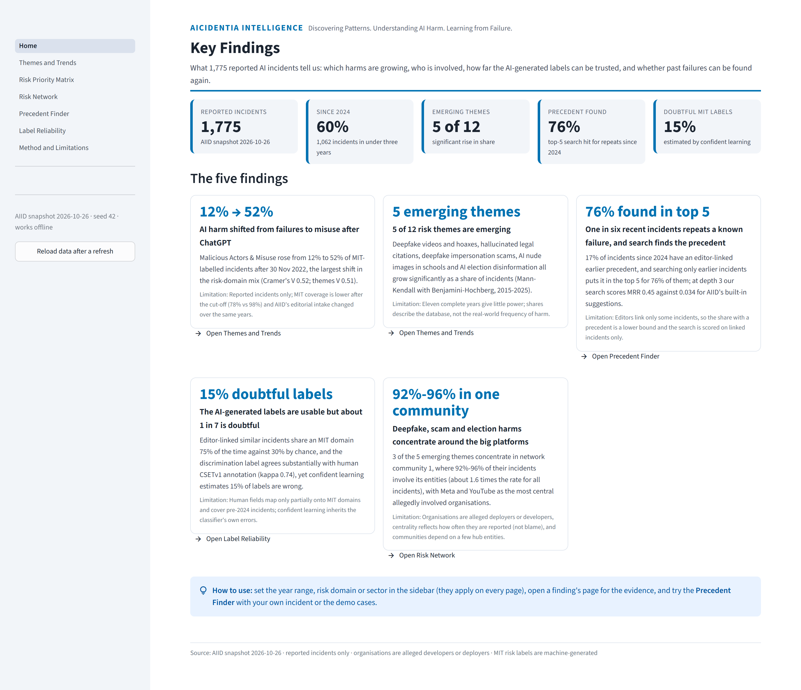
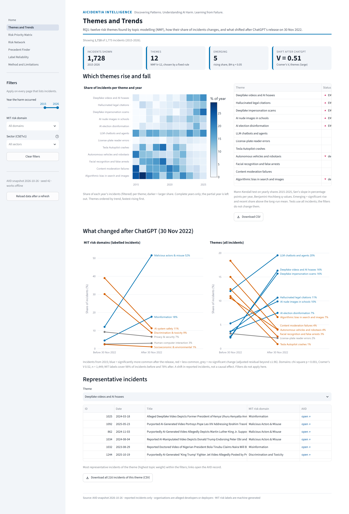
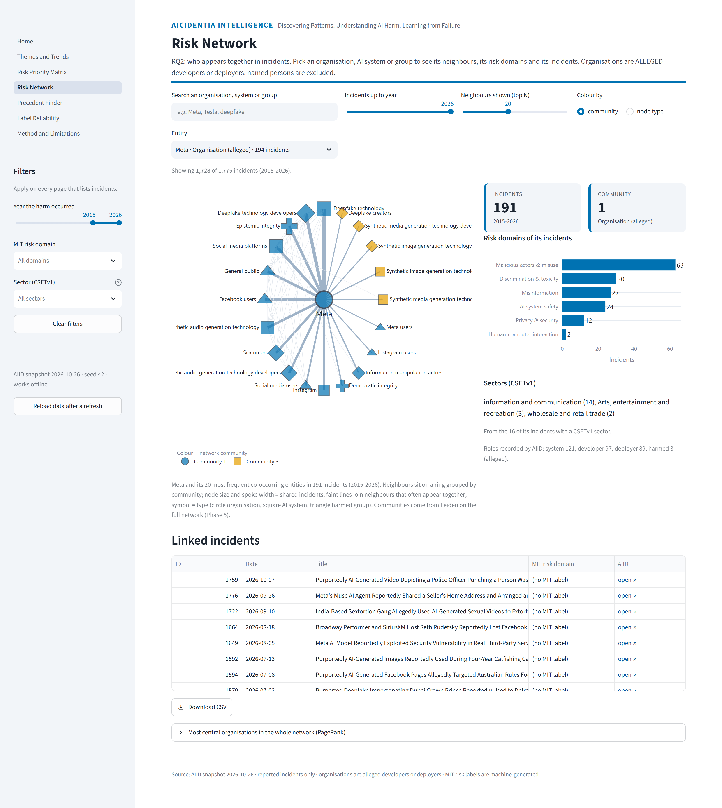
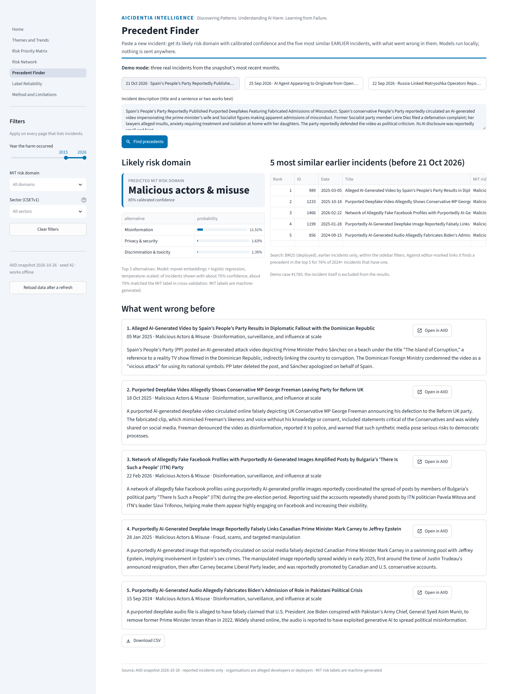
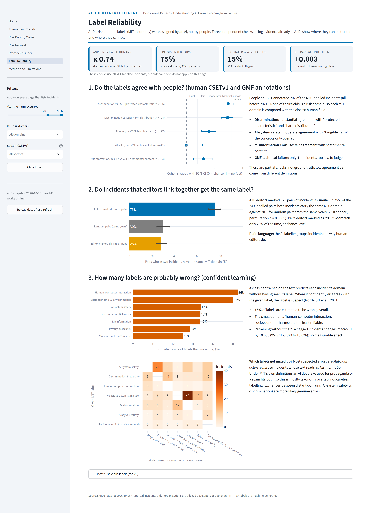

# AICIDENTIA

> **Discovering Patterns. Understanding AI Harm. Learning from Failure.**

**Learning from Failure: A Data-Driven Analysis of Reported Real-World AI Incidents**

MSc Data Analytics, Domain Applications project, National College of Ireland (individual work, due 19 Nov 2026).
Dashboard: **AICIDENTIA Intelligence** (Streamlit). Process framework: **CRISP-DM**.



## Overview

AICIDENTIA analyses a frozen snapshot (2026-10-26) of the [AI Incident Database (AIID)](https://incidentdatabase.ai/):
1,775 reported real-world AI incidents and 8,023 reports. It asks:

| RQ | Question | Methods | Headline result |
|----|----------|---------|-----------------|
| RQ1 | Which risk themes exist and how do they change over time? | LDA vs NMF vs BERTopic (rule-based choice); Mann-Kendall + Sen's slope + Benjamini-Hochberg; chi-square before/after ChatGPT | 12 themes; 5 emerging (deepfakes, deepfake scams, hallucinated legal citations, AI nude images in schools, election disinformation); misuse rose from 12% to 52% of labelled incidents after Nov 2022 |
| RQ2 | Which organisations, systems and groups cluster together? | Entity co-occurrence network, centrality, Louvain vs Leiden vs label propagation | 11 Leiden communities (modularity 0.36); deepfake, scam and election harms concentrate around the big platforms (alleged) |
| RQ3 | Can incidents be classified into risk domains, and how reliable are AIID's AI-generated labels? | TF-IDF, sentence embeddings, DistilBERT with nested CV and a time split; CSETv1/GMF agreement, editor-linked pairs, confident learning | mpnet + LR macro-F1 0.651; labels agree with editors (75% vs 30% chance) but about 15% are probably wrong |
| RQ4 | Can similar, earlier incidents be retrieved? | TF-IDF vs BM25 vs embeddings vs hybrid, scored against editor-marked similar incidents | BM25 finds an editor-linked precedent in the top 5 for 76% of 2024+ repeats; MRR@3 0.45 vs 0.03 for AIID's suggestions |

The five key findings, with numbers and limitations, are in [`docs/key_findings.md`](docs/key_findings.md); every
citable number is in [`docs/report_facts.md`](docs/report_facts.md); every rule and decision is in
[`docs/decisions.md`](docs/decisions.md). The pipeline picture is [`docs/methods_overview.svg`](docs/methods_overview.svg).

## Setup

Prerequisites: [uv](https://docs.astral.sh/uv/) and git.

```bash
uv sync --all-extras          # Python 3.13.12 and every pinned dependency from uv.lock (keep --all-extras)
cp .env.example .env          # optional: HF_HOME / PLAYWRIGHT_BROWSERS_PATH to keep caches off a small drive
uv run nbstripout --install   # once per clone: strip notebook outputs on commit
```

**torch / GPU.** On Windows and Linux, `pyproject.toml` pulls the CUDA 13.2 build of torch. For a CPU-only machine,
change the index URL in `[[tool.uv.index]]` from `.../whl/cu132` to `.../whl/cpu` and run `uv lock && uv sync --all-extras`.
Without uv: `python -m venv .venv`, activate it, then `pip install -r requirements.txt && pip install -e . --no-deps`.

**Data.** Download the AIID Excel export (`AIID_Excel_Export-YYYYMMDD.xlsx`) and the full database dump into
`data/raw/` (nothing is downloaded automatically), set `snapshot_date` in `config/config.yaml`, and run
`uv run python scripts/check_data.py` once; it records SHA-256 hashes in `docs/data_manifest.md`.

## Run everything

```bash
uv run python scripts/run_all.py
```

Regenerates every table, figure, registry entry and document from `data/raw` in about 2 minutes with warm caches
(first run: longer, embeddings and topic fits are computed and cached in `data/interim/`): verify the raw files
against the manifest -> Phase 1 audit -> rules D2/D3 -> Phases 2-7 -> story (key findings) -> fact sheet ->
dashboard check, with a timing summary. A rerun leaves git unchanged (the script checks and reports it).

| Task | Command |
|------|---------|
| Everything from raw data | `uv run python scripts/run_all.py` |
| Re-apply the manual/rule files only (Phases 2-7, story, docs) | `uv run python scripts/refresh_all.py` |
| Fine-tune DistilBERT on the local GPU (same folds as Colab) | `uv run python scripts/train_distilbert_local.py` |
| Dashboard | `uv run streamlit run app/Home.py` |
| Dashboard screenshots (`reports/figures/dashboard/`) | `uv run python scripts/capture_dashboard.py` |
| Backup demo video (`reports/demo/backup_demo.webm`) | `uv run python scripts/record_demo.py` |
| Tests / lint | `uv run pytest` · `uv run ruff check .` |
| One phase at a time | `scripts/run_phase1_audit.py` ... `run_phase7_retrieval.py`, `run_story.py` |

Notebooks run top to bottom in order: `01_data_audit` -> `02_cleaning_eda` -> `03_rq1_themes_trends` ->
`04_rq2_network` -> `05_rq3_classification_reliability` -> `06_rq4_similarity` -> `07_story_synthesis`
(`colab_distilbert_finetune.ipynb` is the Colab alternative to the local GPU script).

## Dashboard

`uv run streamlit run app/Home.py` opens **AICIDENTIA Intelligence**: Key Findings, Themes and Trends, Risk Priority
Matrix, Risk Network, Precedent Finder (with a demo mode), Label Reliability, Method and Limitations. It reads only
precomputed artefacts, works offline, and every page loads in under 3 seconds. Global sidebar filters (year range,
risk domain, sector) apply on every page; tables link to AIID and download as CSV. Details: [`docs/dashboard.md`](docs/dashboard.md).

| | |
|---|---|
|  |  |
|  |  |

## Reproducibility

- Python 3.13.12 (`.python-version`), every dependency pinned in `uv.lock` (`requirements.txt` exports the same pins);
  machine details in [`docs/environment.md`](docs/environment.md).
- Global seed 42 (`config/config.yaml`); cross-validation folds are fixed once and shared by every model, including
  DistilBERT.
- Frozen data snapshot with SHA-256 hashes; results registry `reports/results.json` (`key -> value, source_file,
  function`): the dashboard, the fact sheet and the documents read numbers from it, never by hand.
- Figures: PNG 300 dpi + SVG at IEEE widths (3.5 in / 7.16 in), colour-blind-safe palette, no save dates.

## Folder guide

```
app/              Streamlit dashboard (Home.py + pages/1-6)
config/           config.yaml (paths, seed, models), entity aliases and type overrides
data/             raw (git-ignored), interim (cache), processed (parquet), manual (rule-answered review files, tracked)
docs/             decisions, key_findings, report_facts, presentation, model_card, datasheet, dashboard,
                  data_audit, data_preparation, rq1_topic_models, rq1_trends, rq2_network, rq3_classification,
                  rq4_similarity, environment, methods_overview.svg
models/           saved classifiers (git-ignored)
notebooks/        01-07, one per CRISP-DM stage / research question, plus the Colab DistilBERT notebook
reports/          results.json, tables/, figures/ (+ dashboard/ screenshots), colab/ (DistilBERT input, predictions)
scripts/          run_all, refresh_all, apply_rules, run_phase1-7, run_story, train_distilbert_local,
                  capture_dashboard, record_demo, check_data, environment/requirements exports
src/aicidentia/   installable package: data, features, models, evaluation, viz, dashboard, pipeline, registry
tests/            pytest suite (unit tests on hand-made data, integration tests on the outputs, every dashboard page)
```

## Ethics

Organisations are *alleged* developers or deployers as AIID records them; centrality is not blame. All named persons
(private or public) are excluded from entity analyses and the dashboard (rule D3). AIID reflects reported, mostly
English-language incidents, so results describe the database, not the real-world frequency of AI harm.

## Citation

```
Savaliya, S. (2026). AICIDENTIA: Learning from Failure. A Data-Driven Analysis of Reported Real-World AI Incidents.
MSc Data Analytics project, National College of Ireland.
Data: AI Incident Database, snapshot 2026-10-26, https://incidentdatabase.ai (CC BY-SA 4.0).
McGregor, S. (2021). Preventing Repeated Real World AI Failures by Cataloging Incidents: The AI Incident Database. AAAI 35(17).
```
