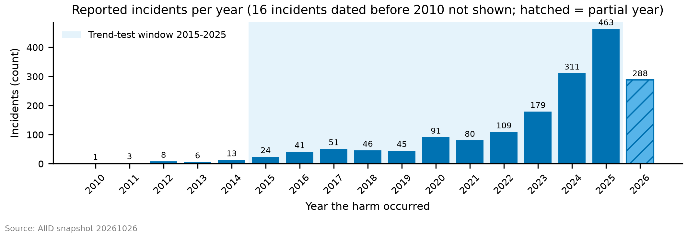
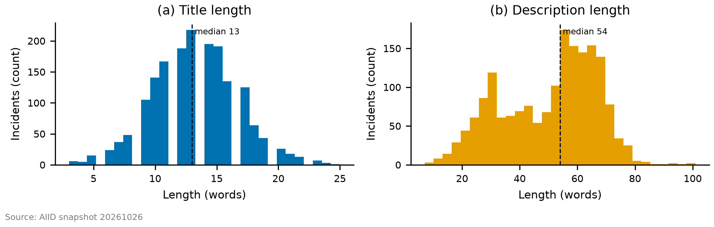
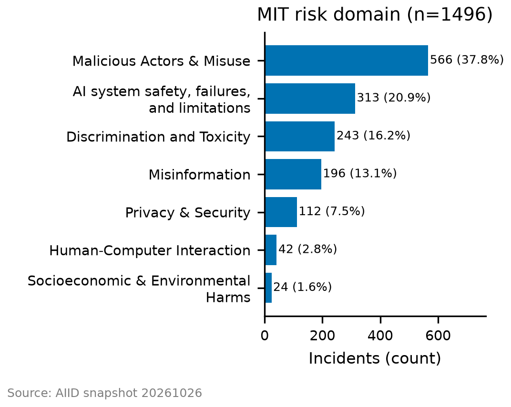
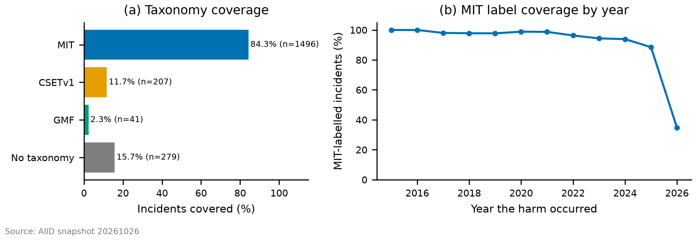
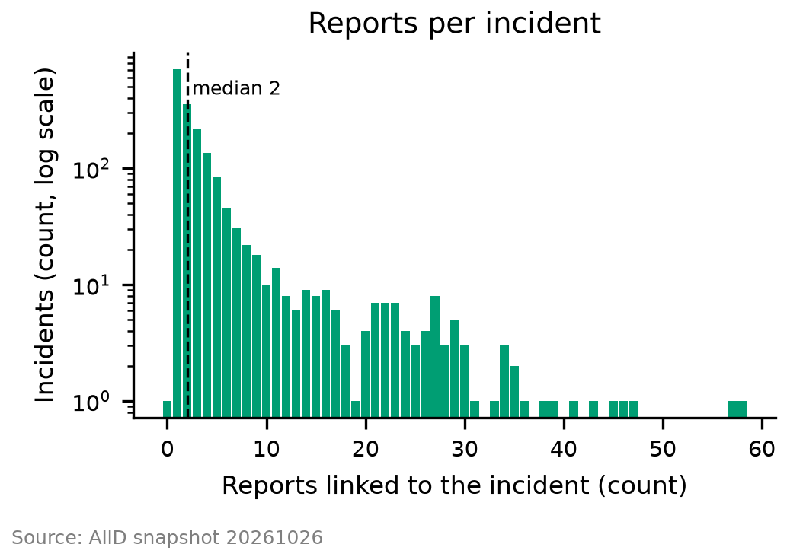

# Data audit (Phase 1: data understanding)

_Auto-generated by `aicidentia.data.audit_docs` from the audit results; re-run `scripts/run_phase1_audit.py` to refresh. AIID snapshot **20261026**. All numbers are registered in `reports/results.json` under `audit.*`._

## Summary

- The Excel export holds **1,775 incidents**, 8,023 reports and 7,609 entities; incidents run **1983-09-26 to 2026-10-22**. 2026 is a **partial year** (288 incidents to 2026-10-22).
- **2.6% of incidents predate 2015**; the series is strongly growing (24 incidents in 2015 to 463 in 2025, x19).
- **MIT Risk Domain** is the only risk-domain label: 1,496 incidents (84.3%), 7 classes, and it is **machine-generated** (taxonomy record has `automatedClassifications = true`). Human-assigned CSETv1 covers about 11.3% and GMF about 2.3%.
- **MIT labels thin out for recent incidents**: 88.6% of 2025 incidents and 34.7% of 2026 incidents are labelled.
- The snapshot is present and adds full article text (99.3% of incidents have a linked report with 50+ words) and **editor-marked similar incidents for 416 incidents (23.4%)**.
- Data issues to handle in Phase 2: Excel entity names are lossy (12% of deployer strings differ from canonical names), 812 stub reports (10.1%), generic/abstract entities mixed with organisations, and a Data Dictionary that overstates three fill rates.

## 1. Files and structure

### Excel export

Each sheet has title/banner rows above the real header (Incidents: header on row 3; Reports and Entities: row 2; Entities also has a blank spacer row). The loader (`aicidentia.data.load`) detects the header row by its first column name. Excel is read with `keep_default_na=False`, because pandas' default would silently turn the literal string `None` into missing (it affects the 279 `Data Sources = None` cells and a few entity cells).

| sheet | rows | columns | count in sheet banner |
|---|---|---|---|
| Incidents | 1775 | 59 | 1775 |
| Reports | 8023 | 12 | 8023 |
| Entities | 7609 | 2 | 7610 |
| Data Dictionary | 59 | 5 |  |
| Coverage Map | 6 | 4 |  |

Row counts match the banners except Entities (7,609 rows vs 7,610 advertised): the snapshot has one entity whose `entity_id` is an empty string, and it is absent from the export.

### Snapshot

`data/raw/mongodump_full_snapshot/` is an already-extracted MongoDB dump (BSON under `aiidprod/` plus CSV exports). No `.tar.bz2` is present, so `scripts/check_data.py` and the loader accept an extracted directory.

| file | size_mb | rows | columns |
|---|---|---|---|
| classifications_CSETv0.csv | 0.13 | 100 | 35 |
| classifications_CSETv1.csv | 0.26 | 214 | 65 |
| classifications_CSETv1_Annotator-1.csv | 0.36 | 298 | 65 |
| classifications_CSETv1_Annotator-2.csv | 0.08 | 106 | 65 |
| classifications_CSETv1_Annotator-3.csv | 0.08 | 81 | 65 |
| classifications_GMF.csv | 0.69 | 326 | 21 |
| classifications_MIT.csv | 0.19 | 1498 | 8 |
| duplicates.csv | 0 | 13 | 2 |
| incidents.csv | 1.33 | 1777 | 9 |
| quickadd.csv | 0.01 | 56 | 4 |
| reports.csv | 43.7 | 8023 | 21 |
| submissions.csv | 0.58 | 59 | 15 |

BSON collections (`aiidprod/`): candidates, checklists, classifications, duplicates, entities, entity_duplicates, entity_relationships, incident_links, incidents, migrations, quickadd, reports, submissions, taxa.

## 2. Data Dictionary cross-check

Observed fill rates in the Incidents sheet were compared with the dictionary's stated rates (tolerance 1 percentage point). 9 of 59 documented columns are flagged:

| column | group | stated_fill | observed_fill | flag |
|---|---|---|---|---|
| Implicated Systems | Identity | 100% | 69.1% | gap > 1pp |
| Editor Notes | Identity | 100% | 30.5% | gap > 1pp |
| Data Sources | Coverage | 100% | 84.3% | gap > 1pp |
| Country Code | CSETv1 | 12% | 7.9% | gap > 1pp |
| Incident Month | CSETv1 | 12% | 8.1% | gap > 1pp |
| Incident Day | CSETv1 | 12% | 4.2% | gap > 1pp |
| AI Task | CSETv1 | 12% | 10.1% | gap > 1pp |
| AI Methods | CSETv1 | 12% | 5.8% | gap > 1pp |
| Data Inputs | CSETv1 | 12% | 10.9% | gap > 1pp |

**Reading:** Implicated Systems, Editor Notes and Data Sources are stated as 100% but are not. The CSETv1 columns are all stated as 12%, a blanket figure; actual fill ranges down to 4%. Use observed fill rates, not the dictionary's. The Coverage Map sheet matches the counts derived from `Data Sources` exactly.

## 3. Incidents

### Time coverage

Dates are the date the **harm occurred**, not when it was reported. 47 incidents (2.6%) fall before 2015, spread over 15 years with at most 13 in any one year. 2026 is partial (to 2026-10-22).

| year | incidents | share | complete | last_incident_date |
|---|---|---|---|---|
| 2010 | 1 | 0.1% | yes | 2010-05-08 |
| 2011 | 3 | 0.2% | yes | 2011-09-20 |
| 2012 | 8 | 0.5% | yes | 2012-12-10 |
| 2013 | 6 | 0.3% | yes | 2013-11-27 |
| 2014 | 13 | 0.7% | yes | 2014-12-22 |
| 2015 | 24 | 1.4% | yes | 2015-12-05 |
| 2016 | 41 | 2.3% | yes | 2016-12-31 |
| 2017 | 51 | 2.9% | yes | 2017-12-23 |
| 2018 | 46 | 2.6% | yes | 2018-12-05 |
| 2019 | 45 | 2.5% | yes | 2019-12-29 |
| 2020 | 91 | 5.1% | yes | 2020-12-27 |
| 2021 | 80 | 4.5% | yes | 2021-12-27 |
| 2022 | 109 | 6.1% | yes | 2022-12-28 |
| 2023 | 179 | 10.1% | yes | 2023-12-29 |
| 2024 | 311 | 17.5% | yes | 2024-12-31 |
| 2025 | 463 | 26.1% | yes | 2025-12-31 |
| 2026 | 288 | 16.2% | PARTIAL | 2026-10-22 |

Monthly counts over the last 24 months range 16-48 (median 33); the two lowest recent months are 2026-08, 2026-10 (the final month is incomplete). Whether recent months are under-recorded because of reporting lag cannot be settled from one snapshot.

*Figure: Reported incidents per year. Source: AIID snapshot 20261026.*

### Duplicates

- Duplicate incident IDs: **0**. Exact duplicate titles: **0** (after normalising case/punctuation: 0). Exact duplicate descriptions: **0**.
- Near-duplicates (TF-IDF cosine on title + description): 1 pair(s) at >= 0.90, 1 at >= 0.80, 3 at >= 0.70. These are candidates for review, not automatic merges, since AIID legitimately holds several incidents about similar events.
- AIID's own merge list (`duplicates.csv`) has 13 pairs. The Excel export already excludes merged duplicates; incidents [88, 637] are still present in the snapshot only. One merge is a chain (342 -> 88 -> 1057), so a `true_incident_number` can itself be a merged duplicate absent from the Excel export; merges must be resolved transitively.

| cosine | incident_a | incident_b | title_a | title_b |
|---|---|---|---|---|
| 0.946 | 74 | 439 | Detroit Police Allegedly Wrongfully Arrested Black Man Due to Purportedly Faulty Facial Recognition Technology | Detroit Police Wrongfully Arrested Black Man Due To Faulty Facial Recognition |
| 0.768 | 230 | 353 | Model 3 Tesla on Autopilot Crashed into a Truck in Florida, Killing Driver | Tesla on Autopilot Crashed into Trailer Truck in Florida, Killing Driver |
| 0.726 | 1462 | 1463 | Purported Deepfake Facebook Advertisement Reportedly Used Bulgarian Actor and TV Host Mihail Bilalov's Likeness to Market Joint-Pain Product | Purported Deepfake Facebook Advertisement Reportedly Used Bulgarian Actor, Director, and Playwright Kamen Donev's Likeness to Market Joint-Pain Product |
| 0.662 | 52 | 353 | Tesla on AutoPilot Killed Driver in Crash in Florida while Watching Movie | Tesla on Autopilot Crashed into Trailer Truck in Florida, Killing Driver |
| 0.66 | 1436 | 1528 | AI-Enabled TruDi Navigation System Was Alleged to Have Contributed to Patient's Stroke During June 2022 Sinus Procedure | AI-Enabled TruDi Navigation System Was Alleged to Have Contributed to Patient's Stroke During May 2023 Sinuplasty |

### Text length

No title or description is empty. Titles: median 13 words (5th-95th percentile 8-19). Descriptions: median 54 words (22-72, max 101), i.e. one short paragraph that fits comfortably inside a 128-token transformer window.

| field | unit | empty | mean | median | p05 | p95 | max |
|---|---|---|---|---|---|---|---|
| title | words | 0 | 13.2 | 13 | 8 | 19 | 25 |
| title | characters | 0 | 98.2 | 98 | 56 | 139 | 195 |
| description | words | 0 | 50.3 | 54 | 22 | 72 | 101 |
| description | characters | 0 | 349 | 380 | 153 | 497 | 680 |

*Figure: Title and description length in words. Source: AIID snapshot 20261026.*

## 4. Labels (MIT, GMF, CSETv1)

**Provenance** (taxonomy records in the snapshot): CSETv0: human-curated, GMF: human-curated, CSETv1: human-curated, MIT: automated. The MIT taxonomy description states its classifications "were generated automatically". The raw MIT records number 1,498, of which 0 carry any notes. MIT labels are therefore an automatically generated reference, not human ground truth.

Coverage, class count and balance per column (multi-valued cells are flattened: classes count label instances; `imbalance` = largest / smallest class). Free-text and numeric columns have no class statistics.

| group | column | kind | coverage | value_type | % multi | n_classes | top_class | top_share | min n | imbalance |
|---|---|---|---|---|---|---|---|---|---|---|
| MIT | Risk Domain | categorical | 1,496 (84.3%) | single-valued | 0% | 7 | Malicious Actors & Misuse | 37.8% | 24 | 23.6 |
| MIT | Risk Subdomain | categorical | 1,495 (84.2%) | single-valued | 0% | 21 | Fraud, scams, and targeted manipulation | 27.6% | 1 | 412.0 |
| MIT | Responsible Entity | categorical | 1,496 (84.3%) | single-valued | 0% | 3 | AI | 64.2% | 11 | 87.3 |
| MIT | Intent | categorical | 1,496 (84.3%) | single-valued | 0% | 3 | Unintentional | 49.5% | 21 | 35.2 |
| MIT | Timing | categorical | 1,496 (84.3%) | single-valued | 0% | 3 | Post-deployment | 97.6% | 9 | 162.2 |
| GMF | AI Goal | categorical | 41 (2.3%) | multi-valued | 12% | 35 | Autonomous Driving | 8.2% | 1 | 4.0 |
| GMF | AI Technology | categorical | 26 (1.5%) | multi-valued | 65% | 25 | Distributional Learning | 16.0% | 1 | 8.0 |
| GMF | AI Technology (Potential) | categorical | 29 (1.6%) | multi-valued | 52% | 22 | Regression | 12.0% | 1 | 6.0 |
| GMF | Technical Failure | categorical | 26 (1.5%) | multi-valued | 50% | 26 | Distributional Bias | 12.2% | 1 | 6.0 |
| GMF | Technical Failure (Potential) | categorical | 36 (2.0%) | multi-valued | 81% | 36 | Generalization Failure | 10.4% | 1 | 11.0 |
| CSETv1 | Harm Domain | categorical | 200 (11.3%) | single-valued | 0% | 3 | yes | 79.0% | 13 | 12.2 |
| CSETv1 | Tangible Harm | categorical | 200 (11.3%) | single-valued | 0% | 5 | no tangible harm, near-miss, or issue | 46.5% | 3 | 31.0 |
| CSETv1 | AI Harm Level | categorical | 200 (11.3%) | single-valued | 0% | 5 | none | 63.0% | 10 | 12.6 |
| CSETv1 | Rights Violation | categorical | 200 (11.3%) | single-valued | 0% | 3 | no | 77.0% | 18 | 8.6 |
| CSETv1 | Harm Distribution Basis | categorical | 197 (11.1%) | multi-valued | 18% | 14 | none | 45.5% | 1 | 122.0 |
| CSETv1 | Lives Lost | numeric | 206 (11.6%) | single-valued | 0% |  |  |  |  |  |
| CSETv1 | Injuries | numeric | 206 (11.6%) | single-valued | 0% |  |  |  |  |  |
| CSETv1 | Sector of Deployment | categorical | 200 (11.3%) | multi-valued | 32% | 18 | information and communication | 30.3% | 1 | 81.0 |
| CSETv1 | Public Sector Deployment | categorical | 200 (11.3%) | single-valued | 0% | 3 | no | 78.0% | 3 | 52.0 |
| CSETv1 | Infrastructure Sectors | categorical | 54 (3.0%) | multi-valued | 2% | 12 | transportation | 25.5% | 1 | 14.0 |
| CSETv1 | Location Region | categorical | 200 (11.3%) | single-valued | 0% | 7 | North America | 47.5% | 1 | 95.0 |
| CSETv1 | Country Code | categorical | 140 (7.9%) | single-valued | 0% | 26 | US | 65.0% | 1 | 91.0 |
| CSETv1 | Location City | categorical | 54 (3.0%) | single-valued | 0% | 42 | Los Angeles | 9.3% | 1 | 5.0 |
| CSETv1 | Incident Year | numeric | 200 (11.3%) | single-valued | 0% |  |  |  |  |  |
| CSETv1 | Incident Month | categorical | 143 (8.1%) | single-valued | 0% | 14 | December | 12.6% | 1 | 18.0 |
| CSETv1 | Incident Day | categorical | 74 (4.2%) | single-valued | 0% | 29 | 29 | 6.8% | 1 | 5.0 |
| CSETv1 | Intentional Harm | categorical | 198 (11.2%) | single-valued | 0% | 4 | No. Not intentionally designed to perform harm | 91.9% | 1 | 182.0 |
| CSETv1 | Autonomy Level | categorical | 200 (11.3%) | single-valued | 0% | 4 | Autonomy1 | 52.0% | 16 | 6.5 |
| CSETv1 | AI Task | free_text | 168 (9.5%) | multi-valued | 52% |  |  |  |  |  |
| CSETv1 | AI Methods | categorical | 91 (5.1%) | multi-valued | 47% | 67 | computer vision | 13.1% | 1 | 20.0 |
| CSETv1 | AI System Description | free_text | 196 (11.0%) | single-valued | 0% |  |  |  |  |  |
| CSETv1 | Data Inputs | categorical | 193 (10.9%) | multi-valued | 75% | 254 | text | 7.6% | 1 | 40.0 |
| CSETv1 | Involving Minor | categorical | 200 (11.3%) | single-valued | 0% | 3 | no | 89.0% | 4 | 44.5 |
| CSETv1 | Protected Characteristic | categorical | 200 (11.3%) | single-valued | 0% | 3 | no | 63.5% | 4 | 31.8 |
| CSETv1 | AI System | categorical | 200 (11.3%) | single-valued | 0% | 3 | yes | 80.5% | 11 | 14.6 |
| CSETv1 | Detrimental Content | categorical | 200 (11.3%) | single-valued | 0% | 3 | no | 77.0% | 7 | 22.0 |
| CSETv1 | Impact on Critical Services | categorical | 200 (11.3%) | single-valued | 0% | 3 | no | 90.0% | 2 | 90.0 |
| CSETv1 | Multiple AI Interaction | categorical | 200 (11.3%) | single-valued | 0% | 3 | no | 97.0% | 1 | 194.0 |
| CSETv1 | Embedded | categorical | 200 (11.3%) | single-valued | 0% | 3 | no | 72.5% | 3 | 48.3 |
| CSETv1 | Entities | free_text | 200 (11.3%) | multi-valued | 100% |  |  |  |  |  |
| CSETv1 | Physical Objects | categorical | 200 (11.3%) | single-valued | 0% | 3 | no | 68.0% | 2 | 68.0 |
| CSETv1 | Deployed | categorical | 200 (11.3%) | single-valued | 0% | 3 | yes | 92.5% | 3 | 61.7 |
| CSETv1 | Estimated Date | categorical | 207 (11.7%) | single-valued | 0% | 2 | False | 66.7% | 69 | 2.0 |
| CSETv1 | Estimated Harm Quantities | categorical | 207 (11.7%) | single-valued | 0% | 2 | False | 92.8% | 15 | 12.8 |
| CSETv1 | Special Interest Intangible Harm | categorical | 200 (11.3%) | single-valued | 0% | 3 | yes | 51.5% | 10 | 10.3 |

### MIT risk domain

| class | n | share |
|---|---|---|
| Malicious Actors & Misuse | 566 | 37.8% |
| AI system safety, failures, and limitations | 313 | 20.9% |
| Discrimination and Toxicity | 243 | 16.2% |
| Misinformation | 196 | 13.1% |
| Privacy & Security | 112 | 7.5% |
| Human-Computer Interaction | 42 | 2.8% |
| Socioeconomic & Environmental Harms | 24 | 1.6% |

*Figure: MIT risk-domain class balance. Source: AIID snapshot 20261026.*

*Figure: Taxonomy coverage and MIT label coverage by year. Source: AIID snapshot 20261026.*

Class counts on either side of a candidate time split (train: before 2024, test: 2024 onward):

| class | n_before_2024 | n_from_2024 | test_share |
|---|---|---|---|
| Malicious Actors & Misuse | 125 | 441 | 77.9% |
| Misinformation | 61 | 135 | 68.9% |
| AI system safety, failures, and limitations | 231 | 82 | 26.2% |
| Discrimination and Toxicity | 183 | 60 | 24.7% |
| Privacy & Security | 60 | 52 | 46.4% |
| Human-Computer Interaction | 19 | 23 | 54.8% |
| Socioeconomic & Environmental Harms | 15 | 9 | 37.5% |

## 5. Entities

**Excel format.** `deployer`, `developer`, `harmed` and `Implicated Systems` are display names joined by `, `. This is ambiguous (**72 entity names contain a comma**) and lossy: the names are slug-derived and title-cased (e.g. "Waddell And Reed", "Texas Aandm University"), so **12% of deployer strings differ from the canonical Entities-sheet names** (case-insensitive comparison).

**Snapshot format.** The same fields are lists of entity slugs (`['navya', 'keolis-north-america']`) that join exactly to the Entities sheet (0 unmatched slugs). The audit and Phase 2 therefore build entities from slugs + Entities sheet.

| role | excel_column | excel_format | snapshot_format | incidents_with_value | fill_rate | unique_entities | entity_mentions | mean_per_incident | max_per_incident |
|---|---|---|---|---|---|---|---|---|---|
| deployer | deployer | names joined by ', ' | list of slugs | 1775 | 100.0% | 2048 | 3995 | 2.25 | 33 |
| developer | developer | names joined by ', ' | list of slugs | 1775 | 100.0% | 750 | 3187 | 1.8 | 12 |
| harmed | harmed | names joined by ', ' | list of slugs | 1774 | 99.9% | 3848 | 7635 | 4.3 | 29 |
| system | Implicated Systems | names joined by ', ' | list of slugs | 1226 | 69.1% | 1167 | 4033 | 2.27 | 27 |

6,954 of 7,609 entities are referenced by an incident; 655 are never referenced.

**Entities are heterogeneous, not just organisations.** The top lists mix companies (OpenAI, Google, Meta) with generic actor classes ("Scammers", "Deepfake creators"), technologies ("Deepfake technology", "Large language models"), and, under `harmed`, abstract values ("Epistemic integrity", "Privacy", "Democratic integrity") next to population groups ("General public", "Minors"). The data has **no entity-type field**; Phase 2 must add one before any network analysis. Facebook and Meta appear as separate entities (alias normalisation needed). Named private individuals also appear among harmed parties.

**Top 20 deployer** (incidents mentioning the entity)

| entity_id | name | incidents | share_of_incidents |
|---|---|---|---|
| scammers | Scammers | 240 | 13.5% |
| deepfake-creators | Deepfake creators | 128 | 7.2% |
| synthetic-media-creators | Synthetic media creators | 105 | 5.9% |
| openai | OpenAI | 85 | 4.8% |
| information-manipulation-actors | Information manipulation actors | 73 | 4.1% |
| google | Google | 63 | 3.5% |
| meta | Meta | 52 | 2.9% |
| facebook | Facebook | 51 | 2.9% |
| tesla | Tesla | 43 | 2.4% |
| cybercriminals | Cybercriminals | 42 | 2.4% |
| law-enforcement | Law enforcement | 40 | 2.3% |
| ai-agent-system-deployers | AI agent system deployers | 37 | 2.1% |
| microsoft | Microsoft | 30 | 1.7% |
| amazon | Amazon | 28 | 1.6% |
| unknown | Unknown | 25 | 1.4% |
| xai | xAI | 23 | 1.3% |
| students | Students | 21 | 1.2% |
| unknown-actors | Unknown actors | 21 | 1.2% |
| waymo | Waymo | 19 | 1.1% |
| chatbot-users | Chatbot users | 18 | 1.0% |

**Top 20 developer** (incidents mentioning the entity)

| entity_id | name | incidents | share_of_incidents |
|---|---|---|---|
| deepfake-technology-developers | Deepfake technology developers | 451 | 25.4% |
| synthetic-audio-generation-technology-developers | Synthetic audio generation technology developers | 241 | 13.6% |
| openai | OpenAI | 193 | 10.9% |
| large-language-model-developers | Large language model developers | 140 | 7.9% |
| synthetic-media-generation-technology-developers | Synthetic media generation technology developers | 132 | 7.4% |
| synthetic-image-generation-technology-developers | Synthetic image generation technology developers | 124 | 7.0% |
| google | Google | 97 | 5.5% |
| unknown | Unknown | 80 | 4.5% |
| chatbot-developers | Chatbot developers | 72 | 4.1% |
| generative-ai-developers | Generative AI developers | 66 | 3.7% |
| meta | Meta | 59 | 3.3% |
| synthetic-video-generation-technology-developers | Synthetic video generation technology developers | 57 | 3.2% |
| tesla | Tesla | 52 | 2.9% |
| facebook | Facebook | 50 | 2.8% |
| ai-agent-system-developers | AI agent system developers | 42 | 2.4% |
| anthropic | Anthropic | 41 | 2.3% |
| microsoft | Microsoft | 39 | 2.2% |
| xai | xAI | 35 | 2.0% |
| amazon | Amazon | 29 | 1.6% |
| facial-recognition-system-developers | Facial recognition system developers | 26 | 1.5% |

**Top 20 harmed** (incidents mentioning the entity)

| entity_id | name | incidents | share_of_incidents |
|---|---|---|---|
| epistemic-integrity | Epistemic integrity | 446 | 25.1% |
| general-public | General public | 354 | 19.9% |
| privacy | Privacy | 191 | 10.8% |
| educational-communities | Educational communities | 106 | 6.0% |
| minors | Minors | 99 | 5.6% |
| democratic-integrity | Democratic integrity | 98 | 5.5% |
| women-and-girls | Women and girls | 97 | 5.5% |
| students | Students | 94 | 5.3% |
| women | Women | 80 | 4.5% |
| national-security-and-intelligence-stakeholders | National security and intelligence stakeholders | 71 | 4.0% |
| social-media-users | Social media users | 70 | 3.9% |
| facebook-users | Facebook users | 69 | 3.9% |
| biometric-data-subjects | Biometric data subjects | 52 | 2.9% |
| journalistic-integrity | Journalistic integrity | 43 | 2.4% |
| victims-of-deepfake-abuse | Victims of deepfake abuse | 41 | 2.3% |
| judicial-integrity | Judicial integrity | 38 | 2.1% |
| chatgpt-users | ChatGPT users | 30 | 1.7% |
| public-figures | Public figures | 28 | 1.6% |
| x-(twitter)-users | X (Twitter) users | 27 | 1.5% |
| chatbot-users | Chatbot users | 27 | 1.5% |

**Top 20 system** (incidents mentioning the entity)

| entity_id | name | incidents | share_of_incidents |
|---|---|---|---|
| deepfake-technology | Deepfake technology | 429 | 24.2% |
| synthetic-audio-generation-technology | Synthetic audio generation technology | 249 | 14.0% |
| large-language-models | Large language models | 164 | 9.2% |
| social-media-platforms | Social media platforms | 145 | 8.2% |
| synthetic-media-generation-technology | Synthetic media generation technology | 131 | 7.4% |
| synthetic-image-generation-technology | Synthetic image generation technology | 123 | 6.9% |
| ai-enabled-decision-support-systems | AI-enabled decision support systems | 120 | 6.8% |
| facebook | Facebook | 104 | 5.9% |
| chatgpt | ChatGPT | 104 | 5.9% |
| chatbots | Chatbots | 81 | 4.6% |
| synthetic-video-generation-technology | Synthetic video generation technology | 58 | 3.3% |
| enterprise-ai-systems | Enterprise AI systems | 56 | 3.2% |
| ai-agent-systems | AI agent systems | 54 | 3.0% |
| facial-recognition-systems | Facial recognition systems | 54 | 3.0% |
| x-(twitter) | X (Twitter) | 47 | 2.6% |
| instagram | Instagram | 37 | 2.1% |
| surveillance-technology | Surveillance technology | 36 | 2.0% |
| tiktok | TikTok | 36 | 2.0% |
| whatsapp | WhatsApp | 33 | 1.9% |
| social-media | Social media | 32 | 1.8% |

## 6. Reports

- 8,023 reports. The Excel Reports sheet has **no incident ID column**; the incident-to-report link exists only in the snapshot (`incidents.reports`), where list lengths equal Excel `report_count` for 100.0% of incidents.
- Reports per incident: mean 3.89, median 2, 90th percentile 8, max 58; **717 incidents (40.4%) have a single report** and 1 has none.
- **812 stub reports (10.1%)** have no title, URL, domain or description and about one word of text; 752 carry placeholder dates (1967/1970). Excluding stubs, report dates span 1996-04-03 to 2026-10-24.
- 1,309 reports are linked to no incident (807 of them stubs; 1,276 flagged `Is Incident Report = False`); 135 reports are shared by several incidents.
- Language: en 7671, es 78, de 32, fr 31, it 31 (English 95.6%). Top source domains: theguardian.com (238), nytimes.com (235), washingtonpost.com (187), reuters.com (159), theverge.com (128).
- Full article text (snapshot `reports.csv`): non-stub reports have a median of 594 words (5th-95th percentile 180-2002); 99.3% of incidents have at least one linked report with 50+ words; median total text per incident 1545 words.

*Figure: Reports per incident (log scale). Source: AIID snapshot 20261026.*

## 7. Snapshot: editor-marked similar incidents

The snapshot's incident records include `editor_similar_incidents`, `editor_dissimilar_incidents` and `nlp_similar_incidents` (AIID's own automatic suggestions). The Excel export has none of these.

| Measure | Value |
|---|---|
| Incidents with >= 1 editor-marked similar incident | 416 (23.4%) |
| Directed links / unique unordered pairs | 486 / 325 |
| Links recorded in both directions | 66.0% |
| Usable queries (links as stored / symmetrised) | 416 / 447 |
| Relevant items per query (mean / median / max) | 1.45 / 1 / 11 |
| Queries with exactly one relevant item | 74.0% |
| Mean upper bound on precision@5 | 0.283 |
| Incidents with editor-marked dissimilar | 145 |
| Incidents with AIID automatic (nlp) suggestions | 1,295 |

## 8. Excel export vs snapshot consistency

The Excel export has 1,775 incidents and the snapshot 1,777; the extra snapshot-only IDs are [88, 637] (merged duplicates). On shared incidents, title, description and date are identical in 100%, 100% and 100% of cases, and Excel `Risk Domain` equals the snapshot MIT classification in 100%. The two sources can be combined without reconciliation.

## DECISIONS

### D1. RQ3 target: human-assigned field (CSET/GMF) or MIT Risk Domain?

**Recommendation: use MIT Risk Domain as the classification target**, and be explicit that it is a machine-generated reference.

| Candidate target | Label source | Incidents labelled | Classes | Largest class | Smallest class (n) | Multi-valued | Fit to 'risk domain' |
|---|---|---|---|---|---|---|---|
| MIT Risk Domain | automatic | 1,496 (84.3%) | 7 | 37.8% | 24 | no | direct: this IS the risk-domain taxonomy |
| CSETv1 Harm Domain | human | 200 (11.3%) | 3 | 79.0% | 13 | no | no: asks whether harm fell in a recognised domain |
| CSETv1 Sector of Deployment | human | 200 (11.3%) | 18 | 30.3% | 1 | 32% | no: industry sector, not a risk |
| GMF AI Goal | human | 41 (2.3%) | 35 | 8.2% | 1 | 12% | no: system purpose, not a risk |

1. **Only MIT Risk Domain is a risk-domain taxonomy** and has enough data for 5-fold stratified cross-validation and a time-based split (1,496 labelled incidents; every human-assigned field covers 200 or fewer).
2. **No human field answers the research question.** CSETv1 Harm Domain is a three-way flag about whether harm fell into a recognised domain; Sector of Deployment is an industry sector with 18 classes, 32% multi-valued and a smallest class of 1; GMF has 41 incidents and 22-36 sparse classes per field.
3. **Caveat that shapes how RQ3 is framed.** Because MIT labels are automatic, classifier accuracy measures how well text reproduces an automated labeller, not agreement with human judgement. RQ3 is therefore reported as two linked findings: (i) how predictable the MIT label is from text; (ii) how reliable the label is, judged against independent signals already in AIID (human CSETv1/GMF annotations, editor-linked pairs, confident learning).
4. **Imbalance.** Largest class 37.8% (Malicious Actors & Misuse), smallest 24 (Socioeconomic & Environmental Harms); ratio 23.6:1. A majority-class baseline already scores 37.8% accuracy, so **macro-F1 is the primary metric**, with `class_weight="balanced"` and per-class results. With 5 folds the smallest class has about 4 test cases per fold, so report bootstrap CIs and do not merge classes unless you approve it.
5. **Time split is feasible but is a shift test.** Before 2024 there are 694 labelled incidents; from 2024, 802. The smallest test class has 9 incidents (Socioeconomic & Environmental Harms). Class mix shifts: 78% of all 'Malicious Actors & Misuse' incidents fall in 2024 or later. MIT labelling thins out for recent incidents (88.6% labelled in 2025, 34.7% in 2026), so the test set contains only labelled incidents and may differ from the unlabelled remainder.
6. **Optional extra, not a replacement:** CSETv1 Sector of Deployment (n=200) could serve as a small human-labelled robustness check in Phase 6.
7. **Audit sampling (for Phase 6):** a purely proportional stratified sample of 150 would give the two smallest domains about 2-4 incidents each; recommend a per-domain floor (e.g. at least 10 each) with the rest allocated proportionally, and weighting when computing overall agreement.

### D2. Can RQ4 use editor-marked links as ground truth?

**Recommendation: yes.** The snapshot provides `editor_similar_incidents` for 416 incidents (486 links, 325 unique pairs; 100% of links have both ends in the Excel export). Treating a link as symmetric gives **447 evaluation queries** (66% of links are already recorded in both directions). The manual-judgement fallback (`retrieval_judgements.csv`) is therefore not needed for the main evaluation.

- **Sparse positives:** a query has a mean of 1.45 relevant items (median 1; 74% have exactly one), so the mean ceiling for precision@5 is **0.28**, not 1.0. Report **recall@5, MRR and nDCG@5 as primary metrics**, and precision@5 as secondary with this ceiling stated.
- **Unmarked is not dissimilar:** editors mark only some similar pairs, so unmarked retrieved items are not necessarily errors; metrics are pessimistic for precision. The 145 incidents with editor-marked dissimilar items can serve as hard negatives.
- **Possible circularity:** AIID stores its own automatic suggestions (`nlp_similar_incidents`, 1,295 incidents). If editors saw them, methods close to AIID's own embedding will look better. The snapshot cannot tell us whether they did; state this as a limitation.
- Exclude the query itself, and the merged duplicates, from the candidates.

### D3. Year range for trend tests (complete years only)

**Recommendation: 2015-2025** (11 annual points; 44 quarters). 2026 is excluded because it is partial (288 incidents to 2026-10-22); it is shown, flagged, in the dashboard only. The start year is the earliest from which every complete year has at least 20 incidents (smallest in the window: 24); 15 earlier years hold 47 incidents in total, at most 13 per year, too few for per-theme shares.

- **Growth is the main confound.** Yearly counts rise x19 across the window (24 to 463); this mixes real-world change with AIID collection effort. A Mann-Kendall test on raw counts is therefore likely to flag most themes as increasing (to be checked in Phase 4). Use **yearly shares as primary**, counts as secondary, and the report-count-weighted version as the media-attention sensitivity (Phase 4).
- **Low power at n=11.** Mann-Kendall on 11 points detects only strong monotone trends; use the Benjamini-Hochberg correction as specified and state this. Run a sensitivity window 2018-2025 (8 years, every year >= 45 incidents).
- **MIT-domain trends need care:** label coverage drops to 88.6% in 2025, so compute shares over labelled incidents and say so.
- **Forecasting:** 44 quarterly points allow a rolling-origin comparison for the total and for the largest themes only; per-theme quarterly counts in the early years are close to zero.

### D4. Which text field(s) to model?

**Recommendation: `text = title + ". " + description` as the primary modelling field** for topics, classification and retrieval.
- 100% populated, editor-written and uniform: description median 54 words (95th percentile 72), title median 13.
- It is available from the Excel export alone (reproducible without the optional snapshot) and fits comfortably in a CPU-friendly 128-256 token window.
- Full report text is available in the snapshot (99.3% of incidents), but it is heterogeneous news prose (median 594 words per report, up to 2002 at the 95th percentile), exceeds a 512-token window, varies in depth (1 to 58 reports per incident; 40% have just one) and includes 812 stubs that must be excluded.
- **Ablation, not default:** test the first ~256 words of the longest non-stub linked report as an extra input for embedding-based classification and retrieval, to show whether longer text helps. For topic modelling start with title + description for comparability across LDA, NMF and BERTopic.
- Provenance of the text the MIT labeller saw is not documented in the snapshot; do not assume the editor description is its input.

### Further decisions and flags carried into Phase 2

- **Source of truth.** Excel for incidents and labels; snapshot for entity slugs, incident-to-report links, full text and similarity links; Entities sheet for display names.
- **Entities.** Build from slugs, not Excel strings. Add an `entity_type` (organisation, generic actor group, individual, technology/system, abstract harm or value, population group) because the data has none; the network must not treat abstract values as organisations. Resolve Facebook/Meta-style aliases via `config/entity_aliases.yaml`. Identify named private individuals for your review in `data/manual/entity_review.csv`.
- **Duplicates.** Resolve merges transitively (342 -> 88 -> 1057); review the near-duplicate pair at cosine 0.95 (incidents 74 and 439) before deciding.
- **Reports.** Drop 812 stub reports; keep the 502 non-stub unlinked reports out of incident-level text.
- **Dictionary.** Do not rely on the Data Dictionary fill rates (section 2).

## Limitations of this audit

- One snapshot: reporting lag and later editing cannot be measured.
- Near-duplicate detection uses TF-IDF cosine on title + description only; it will miss paraphrases.
- Class balance is computed over label instances; multi-valued columns count each value.
- `kind` (categorical / free text / numeric) is a heuristic used only to choose which statistics to show.
- The audit describes the database, not the world: AIID covers **reported** incidents, mostly English-language, mostly recent.

