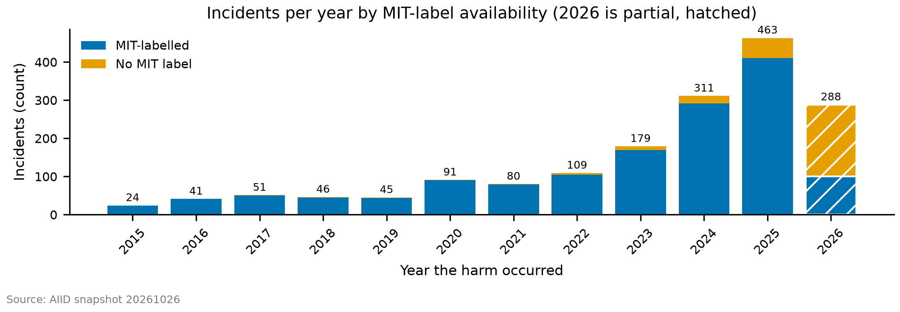
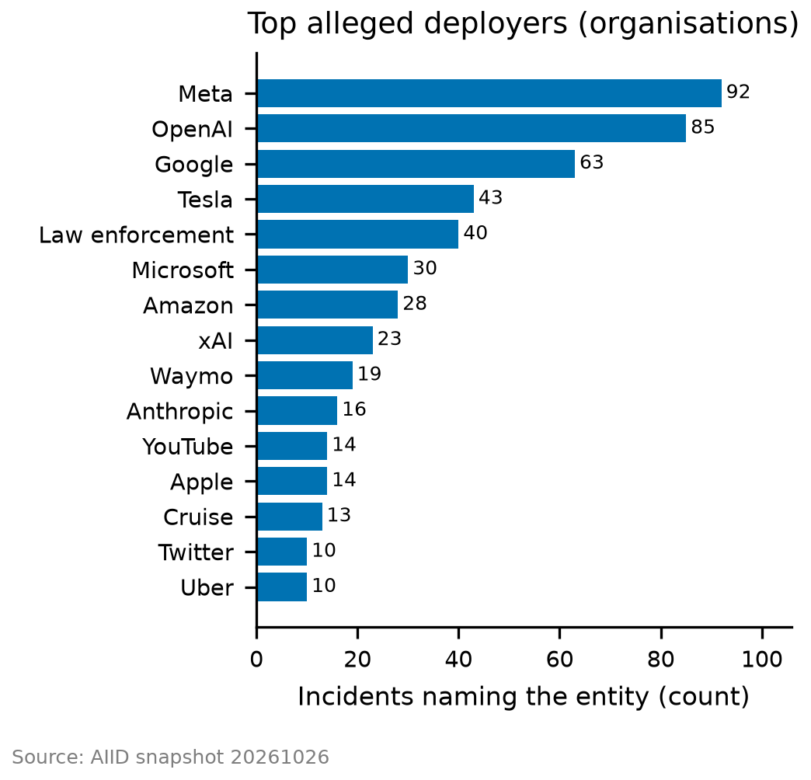
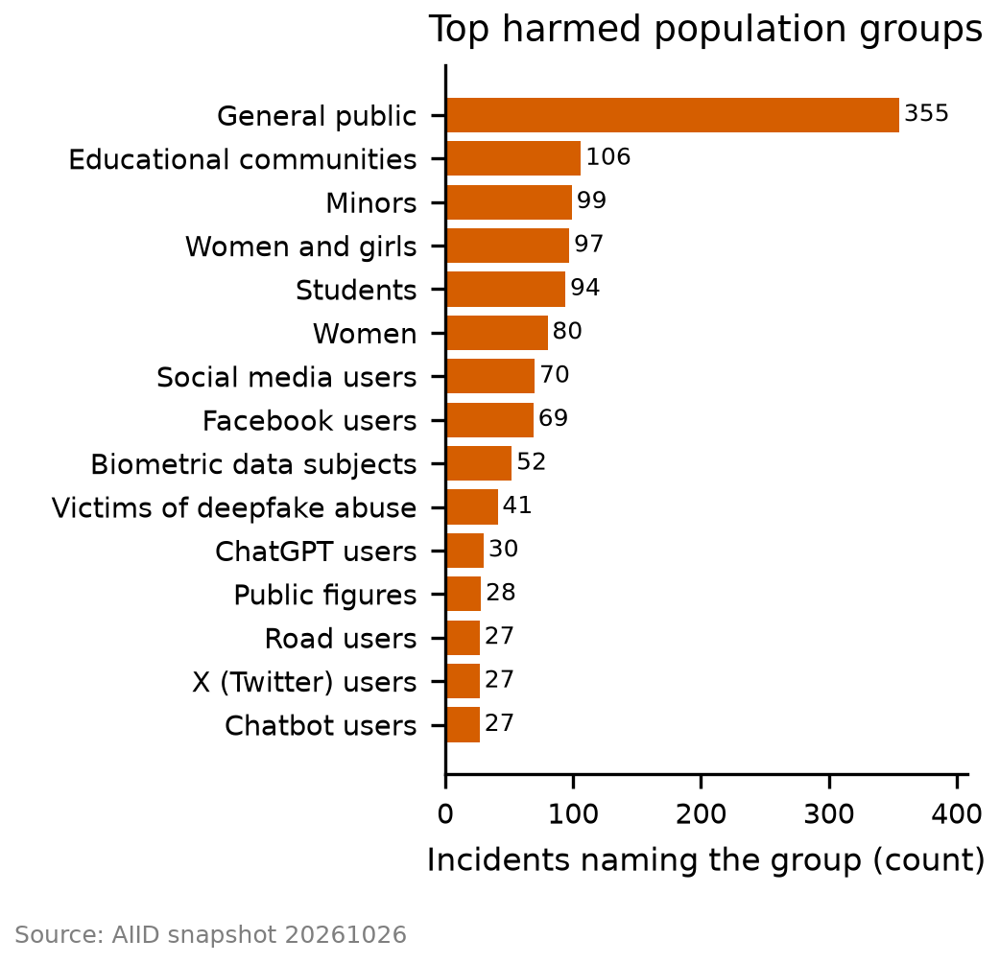
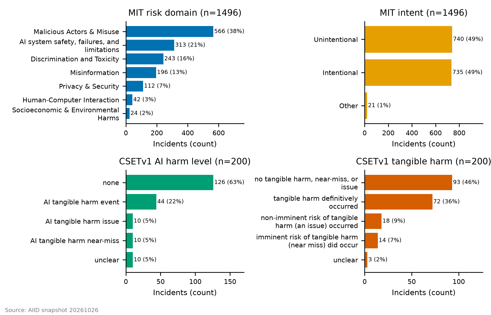

# Data preparation (Phase 2)

_Auto-generated from `aicidentia.data.prepare` (AIID snapshot **20261026**); re-run `scripts/run_phase2_prepare.py` to refresh. Numbers are registered in `reports/results.json` under `prep.*`. Raw files in `data/raw/` are never modified._

## Outputs (`data/processed/*.parquet`, git-ignored)

| Table | Rows | What it is |
|---|---|---|
| `incidents_clean` | 1,775 | one row per incident: ids, dates, `text`, report counts, tidied MIT/GMF/CSETv1 labels |
| `incident_entities` | 17,418 | long table (incident, role, canonical entity, `entity_type`) |
| `entity_table` | 5,786 | one row per canonical entity: name, type, incident count, roles |
| `reports_clean` | 7,211 | non-stub reports with full text and linked incident ids |

## Cleaning decisions

- **Sources.** Excel for incidents and labels; snapshot for entity slugs, incident-to-report links and full text (Phase 1 decision). Excel entity strings are not used (lossy).
- **Text field.** `text = title + ". " + description` (no doubled full stop). Whitespace is collapsed; no lower-casing or stop-word removal here (that belongs to feature extraction).
- **Time.** `year`, `quarter` (1-4) and `year_quarter` (e.g. `2024Q3`) from the harm date.
- **Labels.** Columns are prefixed `mit_`, `gmf_`, `cset_` in snake_case. JSON-list cells become real lists (missing = empty list), True/False columns become nullable booleans, numeric columns nullable numbers, domain numbering is stripped. The CSETv1 `Entities` structure is kept as the JSON string `cset_entities_json`. Flags `has_mit`, `has_gmf`, `has_cset` come from `Data Sources`.
- **Dropped columns.** `Editors`, `Date Modified`, `Editor Notes` (editor ids/notes, modification date) and the four Excel entity columns (rebuilt from slugs). From reports: `Authors`, `Submitters` (names of journalists and submitters, data minimisation).
- **Reports.** 812 stub reports (no title, URL or text) removed; 502 real reports not linked to any incident are kept (flag `linked = False`). Implausible dates (before 1990 or after the snapshot) become missing. `report_count_clean` (non-stub linked reports) differs from the published `report_count` for 5 incidents (linked stubs). 1 incident has no real report.

## Duplicate incidents

- AIID's merge list has 13 pairs, resolved transitively (13 ids). The Excel export already excludes merged incidents (merged ids present in Excel: none), so no incident was removed by this step.
- **Near-duplicate candidates:** 8 pairs with TF-IDF cosine >= 0.6 in `data/manual/duplicate_review.csv`, answered by rule D2 (`docs/decisions.md`): merge only when the incidents share a deployer, are at most 7 days apart and have similarity >= 0.90; otherwise `keep_separate` (8 answered, 0 merges applied).

| incident_a | incident_b | cosine | title_a | title_b |
|---|---|---|---|---|
| 74 | 439 | 0.946 | Detroit Police Allegedly Wrongfully Arrested Black Man Due to Purportedly Faulty Facial Recognition Technology | Detroit Police Wrongfully Arrested Black Man Due To Faulty Facial Recognition |
| 230 | 353 | 0.768 | Model 3 Tesla on Autopilot Crashed into a Truck in Florida, Killing Driver | Tesla on Autopilot Crashed into Trailer Truck in Florida, Killing Driver |
| 1462 | 1463 | 0.726 | Purported Deepfake Facebook Advertisement Reportedly Used Bulgarian Actor and TV Host Mihail Bilalov's Likeness to Market Joint-Pain Product | Purported Deepfake Facebook Advertisement Reportedly Used Bulgarian Actor, Director, and Playwright Kamen Donev's Likeness to Market Joint-Pain Product |
| 52 | 353 | 0.662 | Tesla on AutoPilot Killed Driver in Crash in Florida while Watching Movie | Tesla on Autopilot Crashed into Trailer Truck in Florida, Killing Driver |
| 1436 | 1528 | 0.66 | AI-Enabled TruDi Navigation System Was Alleged to Have Contributed to Patient's Stroke During June 2022 Sinus Procedure | AI-Enabled TruDi Navigation System Was Alleged to Have Contributed to Patient's Stroke During May 2023 Sinuplasty |
| 1655 | 1656 | 0.65 | Suno Allegedly Copied Copyrighted Music Without Permission to Train Its Generative AI Models | Udio Allegedly Copied Copyrighted Sound Recordings Without Permission to Train Its Generative AI Models |
| 52 | 230 | 0.609 | Tesla on AutoPilot Killed Driver in Crash in Florida while Watching Movie | Model 3 Tesla on Autopilot Crashed into a Truck in Florida, Killing Driver |
| 169 | 471 | 0.605 | Facebook Allegedly Failed to Police Anti-Rohingya Hate Speech Content That Contributed to Violence in Myanmar | Facebook Allegedly Failed to Police Hate Speech Content That Contributed to Ethnic Violence in Ethiopia |

## Entities

- **Aliases.** 20 alias mappings are applied (entities used by incidents: 6,956 before, 5,786 after). Sources: AIID's own duplicate list, entities whose names differ only in case/accents/punctuation/Inc, and your manual entries (`facebook -> meta`, the example from the brief). The full list is in `config/entity_aliases.yaml` (sections `manual`, `blocked`, `generated`; your edits to `manual`/`blocked` survive regeneration) and the table below.

| alias | canonical | source | incidents_alias | incidents_canonical |
|---|---|---|---|---|
| meta-ai | meta | aiid_entity_duplicates | 19 | 69 |
| synthetic-media-technology | synthetic-media-generation-technology | aiid_entity_duplicates | 10 | 131 |
| voice-cloning-technology | synthetic-audio-generation-technology | aiid_entity_duplicates | 10 | 249 |
| voice-cloning-technology-developers | synthetic-audio-generation-technology-developers | aiid_entity_duplicates | 10 | 241 |
| synthetic-media-technology-developers | synthetic-media-generation-technology-developers | aiid_entity_duplicates | 6 | 132 |
| minorities | minority-groups | aiid_entity_duplicates | 2 | 24 |
| meta-platforms | meta | aiid_entity_duplicates | 1 | 69 |
| unknown-malicious-actors | malicious-actors | name_normalisation | 9 | 11 |
| unknown-hacker | hackers | name_normalisation | 2 | 7 |
| victims-of-sextortion | unnamed-victims-in-sextortion-schemes | name_normalisation | 2 | 2 |
| video-call-technology | unknown-video-call-technology | name_normalisation | 2 | 2 |
| chatgpt-image-generation-tools | chatgpt-image-generation | name_normalisation | 1 | 1 |
| does-125 | does-1-25 | name_normalisation | 1 | 1 |
| general-public-of-united-kingdom | general-public-of-the-united-kingdom | name_normalisation | 1 | 7 |
| lgbtq-people | lgbtq+-people | name_normalisation | 1 | 1 |
| perplexity.ai | perplexity-ai | name_normalisation | 1 | 7 |
| unknown-pig-butchering-scammers | pig-butchering-scammers | name_normalisation | 1 | 2 |
| scammers-impersonating-elon-musk | unknown-scammers-impersonating-elon-musk | name_normalisation | 1 | 3 |
| social-media-accounts | unknown-social-media-accounts | name_normalisation | 1 | 3 |

AIID pairs **not** applied (3): `scammers` -> `unknown-scammers` (cycle); `synthetic-video-generation-technology` -> `video-generation-technology` (cycle); `synthetic-video-generation-technology-developers` -> `video-generation-technology-developers` (cycle). AIID's list contains cycles and canonical entities that do not exist in the Entities sheet; applying those would rename entities to slugs or merge them arbitrarily.

Parent/subsidiary relationships (Instagram, WhatsApp -> Meta) are not aliases and are not merged; AIID's relationship table only holds symmetric "related" links, not hierarchies.

### Entity types (heuristic)

The data has no entity-type field. `entity_type` is assigned by the ordered rules in `config/entity_types.yaml` (first match wins; the rule is stored in `entity_type_rule`) from the entity's name and the roles it plays. **These are heuristics for grouping, not ground truth**; correct any entity via `overrides` in that file.

| entity_type | entities |
|---|---|
| population_group | 2764 |
| organisation | 1335 |
| technology_system | 1170 |
| generic_actor_group | 446 |
| abstract_value | 70 |
| unknown | 1 |

Top 10 entities per type, to eyeball the rules:

| entity_type | entity | n_incidents | roles | entity_type_rule |
|---|---|---|---|---|
| abstract_value | Epistemic integrity | 448 | developer,harmed,system | harmed_side+abstract_term |
| abstract_value | Privacy | 192 | developer,harmed | harmed_side+abstract_term |
| abstract_value | Democratic integrity | 98 | harmed | harmed_side+abstract_term |
| abstract_value | National security and intelligence stakeholders | 76 | deployer,harmed | harmed_side+abstract_term |
| abstract_value | Journalistic integrity | 43 | harmed | harmed_side+abstract_term |
| abstract_value | Judicial integrity | 38 | harmed | harmed_side+abstract_term |
| abstract_value | Information integrity | 11 | harmed | harmed_side+abstract_term |
| abstract_value | Information security | 10 | harmed | harmed_side+abstract_term |
| abstract_value | Public safety | 6 | harmed | harmed_side+abstract_term |
| abstract_value | Academic integrity | 5 | harmed | harmed_side+abstract_term |
| generic_actor_group | Deepfake technology developers | 451 | developer,system | actor_side+generic_term |
| generic_actor_group | Synthetic audio generation technology developers | 242 | deployer,developer,system | actor_side+generic_term |
| generic_actor_group | Scammers | 240 | deployer | actor_side+generic_term |
| generic_actor_group | Large language model developers | 141 | deployer,developer,harmed,system | actor_side+generic_term |
| generic_actor_group | Synthetic media generation technology developers | 138 | deployer,developer,system | actor_side+generic_term |
| generic_actor_group | Deepfake creators | 137 | deployer,developer | actor_side+generic_term |
| generic_actor_group | Synthetic image generation technology developers | 124 | developer,system | actor_side+generic_term |
| generic_actor_group | Synthetic media creators | 105 | deployer | actor_side+generic_term |
| generic_actor_group | Unknown | 90 | deployer,developer,harmed | actor_side+generic_term |
| generic_actor_group | Information manipulation actors | 73 | deployer,developer | actor_side+generic_term |
| organisation | OpenAI | 194 | deployer,developer,harmed,system | actor_side |
| organisation | Meta | 194 | deployer,developer,harmed,system | actor_side |
| organisation | Google | 102 | deployer,developer,harmed,system | actor_side |
| organisation | Tesla | 54 | deployer,developer,harmed,system | actor_side |
| organisation | Law enforcement | 46 | deployer,harmed | actor_side |
| organisation | Microsoft | 46 | deployer,developer,harmed | actor_side |
| organisation | Anthropic | 42 | deployer,developer,harmed | actor_side |
| organisation | YouTube | 39 | deployer,developer,harmed,system | actor_side_plurality |
| organisation | xAI | 35 | deployer,developer | actor_side |
| organisation | Amazon | 34 | deployer,developer,harmed | actor_side |
| population_group | General public | 355 | harmed | population_term |
| population_group | Educational communities | 106 | deployer,harmed | population_term |
| population_group | Minors | 100 | deployer,harmed | population_term |
| population_group | Students | 98 | deployer,harmed | population_term |
| population_group | Women and girls | 97 | harmed | population_term |
| population_group | Women | 80 | harmed | population_term |
| population_group | Social media users | 75 | deployer,developer,harmed | population_term |
| population_group | Facebook users | 69 | developer,harmed | population_term |
| population_group | Biometric data subjects | 52 | harmed | harmed_side |
| population_group | Victims of deepfake abuse | 41 | harmed | population_term |
| technology_system | Deepfake technology | 429 | developer,system | implicated_system_role |
| technology_system | Synthetic audio generation technology | 250 | developer,system | implicated_system_role |
| technology_system | Large language models | 164 | system | implicated_system_role |
| technology_system | Social media platforms | 146 | deployer,developer,system | implicated_system_role |
| technology_system | Synthetic media generation technology | 141 | system | implicated_system_role |
| technology_system | Synthetic image generation technology | 126 | developer,system | implicated_system_role |
| technology_system | AI-enabled decision support systems | 120 | system | implicated_system_role |
| technology_system | ChatGPT | 115 | deployer,developer,harmed,system | implicated_system_role |
| technology_system | Chatbots | 82 | developer,system | implicated_system_role |
| technology_system | Synthetic video generation technology | 58 | developer,system | implicated_system_role |
| unknown | none | 5 | deployer,developer,harmed | override |

**Known weaknesses seen when spot-checking snapshot 20261026** (do not trust the type of low-frequency entities): class-level institutions (Law firms, Universities, Hospitals) are typed `organisation`; a few company names that look like personal names (Boston Dynamics, Lockheed Martin) are typed `individual_candidate`; platforms that are both a company and an implicated system (for example X (Twitter), 55 incidents) are typed `technology_system`, while the bare entity Twitter is `organisation`. Fix any of these with `overrides` in `config/entity_types.yaml`; the network phase should group by type only after you have glanced at the top entities.

**Possible aliases not applied (your call; add them under `manual:` in `config/entity_aliases.yaml`):** Perplexity / Perplexity AI; Twitter / X (Twitter); Russian government / Government of Russia; Chinese government / Government of China; New York Police Department / New York City Police Department. These pairs were noticed in the frequency lists of this snapshot; whether they are the same entity for your analysis is a judgement.

### Named persons (rule D3)

`data/manual/entity_review.csv` lists **1,158 entities with person-like names** (priority A: named in 1-2 incidents, 1,021; B: 3+ incidents, 21; C: surname ending in -s, which may be a plural group, 116). Rule D3 (`docs/decisions.md`) answers `is_named_person`: every named person, private or public, is excluded; names that are organisations, products or groups are re-typed in `config/entity_types.yaml` and kept. Answered: 1346 of 1346; named persons excluded: 1150. Excluded persons are removed from `incident_entities`, `entity_table`, the network and the dashboard.

Privacy switch: `privacy.exclude_unreviewed_individual_candidates` in `config/config.yaml` is **on**, so any person-like entity not yet reviewed is also excluded (now: 1150 excluded in total; 0 unreviewed). Note that incident titles and descriptions are not edited; they come from AIID and the dashboard links back to AIID.

## Validation

22 checks, 0 failed (the build raises an error on any failure).

| table | check | result | detail |
|---|---|---|---|
| entity_aliases | no self-referential alias | PASS |  |
| entity_aliases | canonical entities exist | PASS | 0 unknown: [] |
| entity_aliases | alias chains fully resolved | PASS |  |
| incidents_clean | no null incident_id | PASS |  |
| incidents_clean | incident_id unique | PASS | 0 duplicates |
| incidents_clean | dates valid (1900 .. snapshot date) | PASS | 0 invalid |
| incidents_clean | year equals date.year | PASS |  |
| incidents_clean | quarter in 1..4 | PASS |  |
| incidents_clean | title non-empty | PASS |  |
| incidents_clean | description non-empty | PASS |  |
| incidents_clean | text starts with title | PASS |  |
| incidents_clean | report_count >= 0 | PASS |  |
| incident_entities | no nulls in key columns | PASS |  |
| incident_entities | roles valid | PASS |  |
| incident_entities | entity_type valid | PASS |  |
| incident_entities | every incident_id exists in incidents_clean | PASS |  |
| incident_entities | no duplicate (incident, role, entity) | PASS | 0 duplicates |
| reports_clean | report_number unique | PASS |  |
| reports_clean | no stub reports (title or url present) | PASS |  |
| reports_clean | published dates plausible | PASS | 0 missing |
| reports_clean | full text present | PASS | 0 missing |
| reports_clean | linked incident ids exist | PASS |  |

## Schema

| table | column | dtype | non_null |
|---|---|---|---|
| incidents_clean | incident_id | int64 | 1775 |
| incidents_clean | date | datetime64[us] | 1775 |
| incidents_clean | year | int64 | 1775 |
| incidents_clean | quarter | int64 | 1775 |
| incidents_clean | year_quarter | str | 1775 |
| incidents_clean | title | str | 1775 |
| incidents_clean | description | str | 1775 |
| incidents_clean | text | str | 1775 |
| incidents_clean | report_count | int64 | 1775 |
| incidents_clean | has_mit | bool | 1775 |
| incidents_clean | has_gmf | bool | 1775 |
| incidents_clean | has_cset | bool | 1775 |
| incidents_clean | mit_risk_domain | string | 1496 |
| incidents_clean | mit_risk_subdomain | string | 1495 |
| incidents_clean | mit_responsible_entity | string | 1496 |
| incidents_clean | mit_intent | string | 1496 |
| incidents_clean | mit_timing | string | 1496 |
| incidents_clean | gmf_ai_goal | object | 41 |
| incidents_clean | gmf_ai_technology | object | 26 |
| incidents_clean | gmf_ai_technology_potential | object | 29 |
| incidents_clean | gmf_technical_failure | object | 26 |
| incidents_clean | gmf_technical_failure_potential | object | 36 |
| incidents_clean | cset_harm_domain | string | 200 |
| incidents_clean | cset_tangible_harm | string | 200 |
| incidents_clean | cset_ai_harm_level | string | 200 |
| incidents_clean | cset_rights_violation | string | 200 |
| incidents_clean | cset_harm_distribution_basis | object | 197 |
| incidents_clean | cset_lives_lost | Int64 | 206 |
| incidents_clean | cset_injuries | Int64 | 206 |
| incidents_clean | cset_sector_of_deployment | object | 200 |
| incidents_clean | cset_public_sector_deployment | string | 200 |
| incidents_clean | cset_infrastructure_sectors | object | 54 |
| incidents_clean | cset_location_region | string | 200 |
| incidents_clean | cset_country_code | string | 140 |
| incidents_clean | cset_location_city | string | 54 |
| incidents_clean | cset_incident_year | Int64 | 200 |
| incidents_clean | cset_incident_month | string | 143 |
| incidents_clean | cset_incident_day | string | 74 |
| incidents_clean | cset_intentional_harm | string | 198 |
| incidents_clean | cset_autonomy_level | string | 200 |
| incidents_clean | cset_ai_task | object | 168 |
| incidents_clean | cset_ai_methods | object | 91 |
| incidents_clean | cset_ai_system_description | string | 196 |
| incidents_clean | cset_data_inputs | object | 193 |
| incidents_clean | cset_involving_minor | string | 200 |
| incidents_clean | cset_protected_characteristic | string | 200 |
| incidents_clean | cset_ai_system | string | 200 |
| incidents_clean | cset_detrimental_content | string | 200 |
| incidents_clean | cset_impact_on_critical_services | string | 200 |
| incidents_clean | cset_multiple_ai_interaction | string | 200 |
| incidents_clean | cset_embedded | string | 200 |
| incidents_clean | cset_entities_json | string | 200 |
| incidents_clean | cset_physical_objects | string | 200 |
| incidents_clean | cset_deployed | string | 200 |
| incidents_clean | cset_estimated_date | boolean | 207 |
| incidents_clean | cset_estimated_harm_quantities | boolean | 207 |
| incidents_clean | cset_special_interest_intangible_harm | string | 200 |
| incidents_clean | report_count_clean | int64 | 1775 |
| incident_entities | incident_id | int64 | 17418 |
| incident_entities | role | str | 17418 |
| incident_entities | entity_id | str | 17418 |
| incident_entities | entity | str | 17418 |
| incident_entities | entity_type | str | 17418 |
| incident_entities | entity_type_rule | str | 17418 |
| incident_entities | entity_id_raw | str | 17418 |
| entity_table | entity_id | str | 5786 |
| entity_table | entity | str | 5786 |
| entity_table | n_incidents | int64 | 5786 |
| entity_table | n_mentions | int64 | 5786 |
| entity_table | roles | str | 5786 |
| entity_table | entity_type | str | 5786 |
| entity_table | entity_type_rule | str | 5786 |
| reports_clean | report_number | int64 | 7211 |
| reports_clean | title | str | 7211 |
| reports_clean | url | str | 7211 |
| reports_clean | source_domain | str | 7211 |
| reports_clean | date_published | datetime64[us] | 7211 |
| reports_clean | date_downloaded | datetime64[us] | 7211 |
| reports_clean | language | str | 7211 |
| reports_clean | tags | str | 829 |
| reports_clean | description | str | 2013 |
| reports_clean | is_incident_report | bool | 7211 |
| reports_clean | text | str | 7211 |
| reports_clean | text_words | int64 | 7211 |
| reports_clean | incident_ids | object | 6709 |
| reports_clean | linked | bool | 7211 |

## Exploratory figures

*Figure: Incidents per year by MIT-label availability. Source: AIID snapshot 20261026.*

*Figure: Top alleged deployers (organisations). Source: AIID snapshot 20261026.*

*Figure: Top harmed population groups. Source: AIID snapshot 20261026.*

*Figure: Label distributions (MIT and CSETv1). Source: AIID snapshot 20261026.*

Top deployers show only entities typed `organisation` and the harmed chart only `population_group`; generic actors, technologies, abstract values and person-like entities are excluded from these charts by design. Organisations are **alleged** deployers; counts are numbers of incident records, not findings of fault.

## Limitations

- Entity types and aliases are heuristic; see the known misclassifications above.
- Person-like names are candidates only; recall of the name heuristic is unknown, and individuals can also appear in titles and descriptions.
- MIT labels are still missing for many recent incidents (Phase 1); `has_mit` marks them.
- The near-duplicate threshold (0.6) is a review aid, not a statement that pairs are duplicates.

