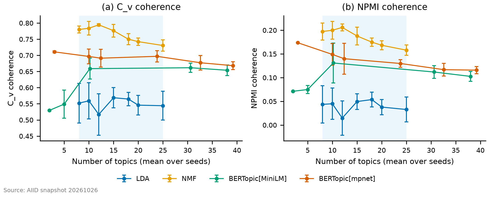
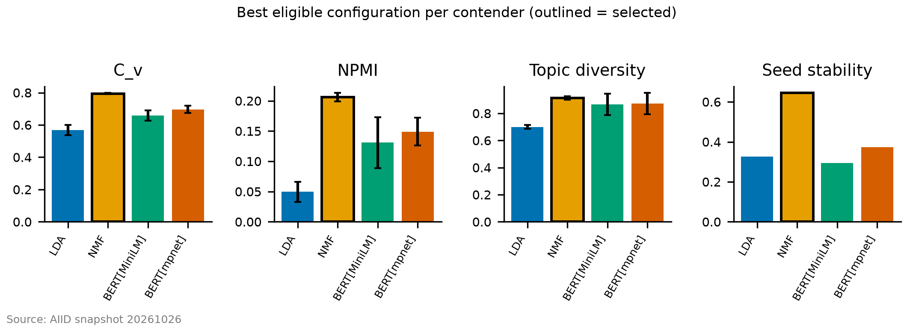
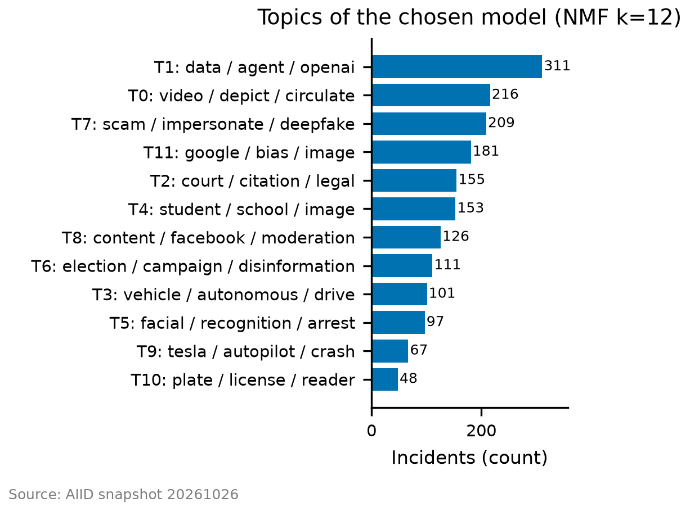

# RQ1a: latent risk themes (Phase 3)

_Auto-generated by `aicidentia.models.topic_outputs` (AIID snapshot **20261026**); re-run `scripts/run_phase3_topics.py` to refresh. Numbers are registered in `reports/results.json` under `rq1a.*`. Fitted models are cached in `data/interim/`._

## Summary

- **Selected model: NMF k=12** (12 topics, seed 42 used for the topic table). C_v 0.794 ± 0.004, NPMI 0.206 ± 0.007, topic diversity 0.913 ± 0.013, seed stability 0.644 (mean ± sd over 5 seeds).
- Under the alternative rules (coherence only, C_v only, NPMI only, without stability) the winner is: **NMF**. The choice is therefore robust to the weighting of the metrics.
- NMF is higher than LDA on 4 of 4 metrics and lower on 0; NMF is higher than BERTopic[MiniLM] on 3 of 4 metrics and lower on 0; NMF is higher than BERTopic[mpnet] on 3 of 4 metrics and lower on 0. In other words, the best advanced contender (BERTopic[mpnet]) beats LDA on 4 of 4 metrics and falls behind on 0; the best advanced contender (BERTopic[mpnet]) beats NMF on 0 of 4 metrics and falls behind on 3.
- 26 configurations x 5 seeds = 130 fits, all scored on one shared tokenised corpus.
- **Topic labels are pending you**: `data/manual/topic_labels.csv` has the top terms, five representative incident titles and an automatic placeholder label per topic, with a blank `final_label` column for you to confirm.

## 1. Method

- **Corpus.** 1,775 incidents, modelled on `text` (title + description). Lower-case, alphabetic tokens of 3+ letters, scikit-learn English stopwords plus 31 domain stopwords (hedging and boilerplate such as *allegedly*, *reportedly*, *system*, *ai*), WordNet lemmatisation (noun then verb), then a document-frequency filter (kept: in at least 3 incidents and at most 50%). Result: vocabulary of 2,955 words, 33.8 tokens per incident on average (minimum 6).
- **LDA** (gensim): batch variational Bayes, learned alpha and eta, 15 passes; k in [8, 10, 12, 15, 18, 20, 25].
- **NMF** (scikit-learn): TF-IDF matrix over the same vocabulary, random initialisation (so seeds differ), same k grid.
- **BERTopic**: sentence embeddings of the untouched text (cached; models: sentence-transformers/all-MiniLM-L6-v2, sentence-transformers/all-mpnet-base-v2), seeded UMAP (5 dimensions, 15 neighbours, cosine), scikit-learn HDBSCAN (min_cluster_size in [15, 20, 25, 30, 40, 50], min_samples 3), c-TF-IDF over the shared vocabulary, and outlier reduction by embedding similarity (every incident ends up in a topic). The number of topics is not set but emerges from min_cluster_size, so the grid was chosen from topic counts only (never from metric values) to cover roughly 8-40 topics.
- **Metrics.** *C_v* and *NPMI* coherence from gensim `CoherenceModel` on the shared tokenised corpus (top 10 words per topic; sliding-window co-occurrence); *topic diversity* (Dieng et al., 2020) = unique words / total words in the topics' top words; *stability* = mean pairwise similarity between the topic sets of different seeds, where topics are matched one-to-one by Jaccard overlap of their top words and the summed Jaccard is divided by the larger topic count (so different topic counts are penalised).
- **Seeds.** 5 seeds (42 to 46); every number is mean ± sd across them.

### Selection rule (fixed before looking at results)

1. A configuration is eligible if its mean number of topics is between 8 and 25 (a number of themes a person can label and trend).
2. Within each contender (LDA, NMF, and BERTopic per embedding model) the best eligible configuration has the best summed rank of mean C_v and mean NPMI (ties: diversity, then stability).
3. Across contenders the winner has the lowest mean rank over C_v, NPMI, topic diversity and seed stability.
4. The winner is re-derived under four alternative weightings as a sensitivity check.

## 2. Results

### Best eligible configuration per contender

| contender | label | n_topics_mean | c_v_mean | c_v_sd | c_npmi_mean | c_npmi_sd | diversity_mean | diversity_sd | stability | outlier_share_before_mean |
|---|---|---|---|---|---|---|---|---|---|---|
| LDA | LDA k=15 | 15 | 0.569 | 0.031 | 0.05 | 0.017 | 0.7 | 0.013 | 0.326 |  |
| NMF | NMF k=12 | 12 | 0.794 | 0.004 | 0.206 | 0.007 | 0.913 | 0.013 | 0.644 |  |
| BERTopic[MiniLM] | BERTopic[MiniLM] mcs=25 | 10.2 | 0.659 | 0.032 | 0.131 | 0.042 | 0.866 | 0.079 | 0.293 | 0.084 |
| BERTopic[mpnet] | BERTopic[mpnet] mcs=40 | 10 | 0.697 | 0.023 | 0.149 | 0.023 | 0.872 | 0.078 | 0.374 | 0.122 |

*Note:* within NMF the rule chose **NMF k=12** (stability 0.644), but **NMF k=15** is the most seed-stable eligible configuration (stability 0.808, C_v 0.776). If reproducibility of the topic set matters more to you than the coherence rank, that is the alternative.

### Cross-contender ranks (1 = best)

| contender | label | rank_c_v | rank_c_npmi | rank_diversity | rank_stability | mean_rank |
|---|---|---|---|---|---|---|
| NMF | NMF k=12 | 1 | 1 | 1 | 1 | 1 |
| BERTopic[mpnet] | BERTopic[mpnet] mcs=40 | 2 | 2 | 2 | 2 | 2 |
| BERTopic[MiniLM] | BERTopic[MiniLM] mcs=25 | 3 | 3 | 3 | 4 | 3.25 |
| LDA | LDA k=15 | 4 | 4 | 4 | 3 | 3.75 |

### Sensitivity of the winner to the weighting

| rule | winner |
|---|---|
| all four metrics (the rule) | NMF |
| coherence only (C_v + NPMI) | NMF |
| C_v only | NMF |
| NPMI only | NMF |
| without stability | NMF |

### Pairwise comparison: selected model and best BERTopic against the others

NMF is higher than LDA on 4 of 4 metrics and lower on 0; NMF is higher than BERTopic[MiniLM] on 3 of 4 metrics and lower on 0; NMF is higher than BERTopic[mpnet] on 3 of 4 metrics and lower on 0. In other words, the best advanced contender (BERTopic[mpnet]) beats LDA on 4 of 4 metrics and falls behind on 0; the best advanced contender (BERTopic[mpnet]) beats NMF on 0 of 4 metrics and falls behind on 3.

| a | b | metric | a_value | b_value | difference | seed_sd (max) | reading |
|---|---|---|---|---|---|---|---|
| NMF | LDA | C_v | 0.794 | 0.569 | 0.226 | 0.031 | NMF higher |
| NMF | LDA | NPMI | 0.206 | 0.05 | 0.156 | 0.017 | NMF higher |
| NMF | LDA | Topic diversity | 0.913 | 0.7 | 0.213 | 0.013 | NMF higher |
| NMF | LDA | Seed stability | 0.644 | 0.326 | 0.319 |  | NMF higher |
| NMF | BERTopic[MiniLM] | C_v | 0.794 | 0.659 | 0.136 | 0.032 | NMF higher |
| NMF | BERTopic[MiniLM] | NPMI | 0.206 | 0.131 | 0.075 | 0.042 | NMF higher |
| NMF | BERTopic[MiniLM] | Topic diversity | 0.913 | 0.866 | 0.047 | 0.079 | within seed noise |
| NMF | BERTopic[MiniLM] | Seed stability | 0.644 | 0.293 | 0.351 |  | NMF higher |
| NMF | BERTopic[mpnet] | C_v | 0.794 | 0.697 | 0.098 | 0.023 | NMF higher |
| NMF | BERTopic[mpnet] | NPMI | 0.206 | 0.149 | 0.057 | 0.023 | NMF higher |
| NMF | BERTopic[mpnet] | Topic diversity | 0.913 | 0.872 | 0.041 | 0.078 | within seed noise |
| NMF | BERTopic[mpnet] | Seed stability | 0.644 | 0.374 | 0.27 |  | NMF higher |
| BERTopic[mpnet] | LDA | C_v | 0.697 | 0.569 | 0.128 | 0.031 | BERTopic[mpnet] higher |
| BERTopic[mpnet] | LDA | NPMI | 0.149 | 0.05 | 0.099 | 0.023 | BERTopic[mpnet] higher |
| BERTopic[mpnet] | LDA | Topic diversity | 0.872 | 0.7 | 0.172 | 0.078 | BERTopic[mpnet] higher |
| BERTopic[mpnet] | LDA | Seed stability | 0.374 | 0.326 | 0.048 |  | BERTopic[mpnet] higher |
| BERTopic[mpnet] | NMF | C_v | 0.697 | 0.794 | -0.098 | 0.023 | NMF higher |
| BERTopic[mpnet] | NMF | NPMI | 0.149 | 0.206 | -0.057 | 0.023 | NMF higher |
| BERTopic[mpnet] | NMF | Topic diversity | 0.872 | 0.913 | -0.041 | 0.078 | within seed noise |
| BERTopic[mpnet] | NMF | Seed stability | 0.374 | 0.644 | -0.27 |  | NMF higher |

### BERTopic: topic count depends strongly on min_cluster_size

HDBSCAN's `min_cluster_size` controls how many clusters survive, and the relationship is not smooth: a small step can collapse the solution to a handful of topics. Share of incidents HDBSCAN left as outliers before reduction is shown alongside.

| label | n_topics_mean | n_topics_sd | outlier_share_before_mean | c_v_mean | c_npmi_mean | eligible |
|---|---|---|---|---|---|---|
| BERTopic[MiniLM] mcs=15 | 38 | 4.95 | 0.194 | 0.654 | 0.103 | False |
| BERTopic[MiniLM] mcs=20 | 30.6 | 2.61 | 0.168 | 0.662 | 0.112 | False |
| BERTopic[MiniLM] mcs=25 | 10.2 | 8.04 | 0.084 | 0.659 | 0.131 | True |
| BERTopic[MiniLM] mcs=30 | 5 | 6.71 | 0.043 | 0.549 | 0.075 | False |
| BERTopic[MiniLM] mcs=40 | 2 | 0 | 0 | 0.53 | 0.071 | False |
| BERTopic[MiniLM] mcs=50 | 2 | 0 | 0 | 0.53 | 0.071 | False |
| BERTopic[mpnet] mcs=15 | 39.2 | 1.3 | 0.195 | 0.668 | 0.116 | False |
| BERTopic[mpnet] mcs=20 | 32.6 | 1.14 | 0.201 | 0.677 | 0.117 | False |
| BERTopic[mpnet] mcs=25 | 23.8 | 2.49 | 0.168 | 0.697 | 0.13 | True |
| BERTopic[mpnet] mcs=30 | 12.4 | 8.62 | 0.12 | 0.691 | 0.14 | True |
| BERTopic[mpnet] mcs=40 | 10 | 6.56 | 0.122 | 0.697 | 0.149 | True |
| BERTopic[mpnet] mcs=50 | 3 | 0 | 0.001 | 0.711 | 0.174 | False |

### Full grid (mean over seeds)

| label | n_topics_mean | c_v_mean | c_v_sd | c_npmi_mean | c_npmi_sd | diversity_mean | stability | eligible |
|---|---|---|---|---|---|---|---|---|
| LDA k=8 | 8 | 0.552 | 0.061 | 0.044 | 0.039 | 0.765 | 0.336 | True |
| LDA k=10 | 10 | 0.559 | 0.056 | 0.045 | 0.033 | 0.752 | 0.313 | True |
| LDA k=12 | 12 | 0.517 | 0.064 | 0.015 | 0.036 | 0.735 | 0.298 | True |
| LDA k=15 | 15 | 0.569 | 0.031 | 0.05 | 0.017 | 0.7 | 0.326 | True |
| LDA k=18 | 18 | 0.565 | 0.021 | 0.054 | 0.015 | 0.691 | 0.322 | True |
| LDA k=20 | 20 | 0.546 | 0.03 | 0.038 | 0.016 | 0.663 | 0.3 | True |
| LDA k=25 | 25 | 0.544 | 0.044 | 0.033 | 0.026 | 0.622 | 0.303 | True |
| NMF k=8 | 8 | 0.78 | 0.011 | 0.197 | 0.018 | 0.93 | 0.721 | True |
| NMF k=10 | 10 | 0.784 | 0.021 | 0.2 | 0.019 | 0.914 | 0.726 | True |
| NMF k=12 | 12 | 0.794 | 0.004 | 0.206 | 0.007 | 0.913 | 0.644 | True |
| NMF k=15 | 15 | 0.776 | 0.02 | 0.188 | 0.019 | 0.915 | 0.808 | True |
| NMF k=18 | 18 | 0.75 | 0.017 | 0.175 | 0.009 | 0.896 | 0.707 | True |
| NMF k=20 | 20 | 0.742 | 0.011 | 0.168 | 0.009 | 0.888 | 0.726 | True |
| NMF k=25 | 25 | 0.73 | 0.017 | 0.158 | 0.011 | 0.859 | 0.673 | True |
| BERTopic[MiniLM] mcs=15 | 38 | 0.654 | 0.016 | 0.103 | 0.01 | 0.744 | 0.579 | False |
| BERTopic[MiniLM] mcs=20 | 30.6 | 0.662 | 0.014 | 0.112 | 0.013 | 0.774 | 0.575 | False |
| BERTopic[MiniLM] mcs=25 | 10.2 | 0.659 | 0.032 | 0.131 | 0.042 | 0.866 | 0.293 | True |
| BERTopic[MiniLM] mcs=30 | 5 | 0.549 | 0.043 | 0.075 | 0.008 | 0.96 | 0.629 | False |
| BERTopic[MiniLM] mcs=40 | 2 | 0.53 | 0 | 0.071 | 0 | 1 | 1 | False |
| BERTopic[MiniLM] mcs=50 | 2 | 0.53 | 0 | 0.071 | 0 | 1 | 1 | False |
| BERTopic[mpnet] mcs=15 | 39.2 | 0.668 | 0.012 | 0.116 | 0.007 | 0.747 | 0.632 | False |
| BERTopic[mpnet] mcs=20 | 32.6 | 0.677 | 0.023 | 0.117 | 0.013 | 0.747 | 0.671 | False |
| BERTopic[mpnet] mcs=25 | 23.8 | 0.697 | 0.018 | 0.13 | 0.008 | 0.769 | 0.601 | True |
| BERTopic[mpnet] mcs=30 | 12.4 | 0.691 | 0.028 | 0.14 | 0.033 | 0.855 | 0.331 | True |
| BERTopic[mpnet] mcs=40 | 10 | 0.697 | 0.023 | 0.149 | 0.023 | 0.872 | 0.374 | True |
| BERTopic[mpnet] mcs=50 | 3 | 0.711 | 0.003 | 0.174 | 0.001 | 0.94 | 0.976 | False |

*Figure: Coherence against number of topics for every configuration (shaded: eligible range). Source: AIID snapshot 20261026.*

*Figure: Best eligible configuration per contender. Source: AIID snapshot 20261026.*

## 3. Chosen model: topics

`NMF k=12`, base seed 42. Sizes are numbers of incidents assigned (each incident gets one dominant topic). The *suggested label* is only the first three terms, an automatic placeholder, not an interpretation.

| topic_id | n_incidents | suggested_label | top_10_terms | example_titles |
|---|---|---|---|---|
| 0 | 216 | video / depict / circulate | video, depict, circulate, generate, deepfake, president, trump, audio, manipulate, falsely | Alleged Deepfake Video Depicts Former President of Kenya Uhuru Kenyatta Announcing 2027 Presidential Bid \|\| Purported AI-Generated Video Portrays Pope Leo XIV Addressing Ibrahim Traoré of Burkina Faso |
| 1 | 311 | data / agent / openai | data, agent, openai, access, user, chatgpt, model, claude, train, personal | OpenAI Research Agent Reportedly Changed a Research Organization's Live Systems and Retrieved Nonpublic Data \|\| AI Agents Under Evaluation Reportedly Accessed Personal and Confidential Records at Indian Organizations |
| 2 | 155 | court / citation / legal | court, citation, legal, case, file, lawyer, chatgpt, attorney, contain, generate | ChatGPT Reportedly Produced False Court Case Law Presented by Legal Counsel in Court \|\| $31,000 Sanction in Lacey v. State Farm Tied to Purportedly Undisclosed Use of LLMs and Erroneous Citations |
| 3 | 101 | vehicle / autonomous / drive | vehicle, autonomous, drive, san, waymo, francisco, cruise, car, self, robotaxi | Two Cruise Autonomous Vehicles Collided with Each Other in California \|\| Driverless Cruise Cars Immobilized in San Francisco Traffic Jam |
| 4 | 153 | student / school / image | student, school, image, create, classmate, nude, generate, explicit, high, female | Male student allegedly used AI to generate nude photos of female classmates at a high school in Issaquah, Washington \|\| Tasmanian School Students Reportedly Created Purported AI-Generated Pornographic Images of Female Classmates |
| 5 | 97 | facial / recognition / arrest | facial, recognition, arrest, police, black, technology, match, man, face, false | Activists Allege NYPD's Application of Facial Recognition Interfered with Right to Protest \|\| Facial Recognition Trial Performed Poorly at Notting Hill Carnival |
| 6 | 111 | election / campaign / disinformation | election, campaign, disinformation, russian, spread, influence, medium, political, target, voter | China Reportedly Intensifying AI to Spread Disinformation to U.S. and Taiwanese Voters \|\| Russia Reportedly Using Artificial Intelligence in Disinformation Campaigns to Erode Western Support for Ukraine |
| 7 | 209 | scam / impersonate / deepfake | scam, impersonate, deepfake, scammer, investment, voice, victim, fake, fraudulent, scheme | Hong Kong Man Reportedly Lost More Than HK$10 Million in WhatsApp Scam Using Purported AI-Generated Voice Impersonation of His Father \|\| Canadian Fraud Ring Allegedly Used AI Voice Cloning in Multi-Year $21 Million Grandparent Scam Targeting Elderly Americans Across 46 States |
| 8 | 126 | content / facebook / moderation | content, facebook, moderation, user, automate, instagram, flag, tiktok, post, meta | Facebook’s and Twitter's Automated Content Moderation Reportedly Failed to Effectively Enforce Violation Rules for Small Language Groups \|\| Facebook Content Moderators Demand Better Working Conditions Due to Allegedly Inadequate AI Content Moderation |
| 9 | 67 | tesla / autopilot / crash | tesla, autopilot, crash, driver, model, kill, mode, truck, park, highway | Tesla on Autopilot Crashed into Trailer Truck in Florida, Killing Driver \|\| Tesla Driver on Autopilot Ran a Red Light, Crashing into a Car and Killing Two People in Los Angeles |
| 10 | 48 | plate / license / reader | plate, license, reader, flock, police, safety, officer, gunpoint, county, automate | Kechi, Kansas, Police Lieutenant Used Flock Safety License-Plate Reader System to Monitor Estranged Wife \|\| Flock Safety License-Plate Reader Reportedly Misread Plate Digit, Prompting Gunpoint Stop of Two Sisters in Española, New Mexico |
| 11 | 181 | google / bias / image | google, bias, image, result, search, racial, gender, feature, gemini, black | Gender Biases in Google Translate \|\| Google Images Showed Racially Biased Results for 'Professional' Hairstyles |

*Figure: Incidents per topic (chosen model). Source: AIID snapshot 20261026.*

## 4. Your action: confirm the topic labels

`data/manual/topic_labels.csv` already existed for this exact topic solution and was left untouched. For each topic it lists the top 10 terms, five representative incident titles with ids, and an automatic placeholder label. **Fill `final_label`** (a short human name for the theme; add `notes` if a topic is incoherent or should be merged with another). Phase 4 will use your confirmed labels; the file carries a `model_key` so that your answers are never silently applied to a different topic solution.

## 5. Limitations

- **Coherence is a proxy for interpretability, not a measurement of it.** C_v and NPMI correlate with, but do not replace, human judgement; your label review is the real test, and a topic can score well and still be uninformative.
- **Short texts.** Incidents are title + description (about 34 tokens after filtering), which limits all three families; co-occurrence statistics are sparse. Full report text could change the ranking (Phase 1 recommended it only as an ablation).
- **Preprocessing choices matter.** The domain stopword list and frequency filter are judgement calls applied equally to all models; different choices would change absolute scores.
- **BERTopic is not tuned to a topic count.** Its configurations are compared at whatever number of topics HDBSCAN yields, so contenders differ in k even inside the eligible range; coherence and diversity are not independent of k.
- **Hard assignment.** Each incident is given one dominant topic; incidents about several themes are forced into one. For the chosen model the median dominant-topic weight is 0.55 and 43% of incidents have a dominant weight below 0.5, i.e. they sit between themes. LDA/NMF weights are kept in the fits but the saved assignment is dominant-topic only.
- **Reporting bias.** Themes describe what AIID editors chose to record, not the prevalence of harms (see the datasheet).
- **One snapshot, one corpus.** Topics are fitted on all 1,775 incidents (including pre-2015 and the partial 2026); trend tests in Phase 4 use complete years only.

