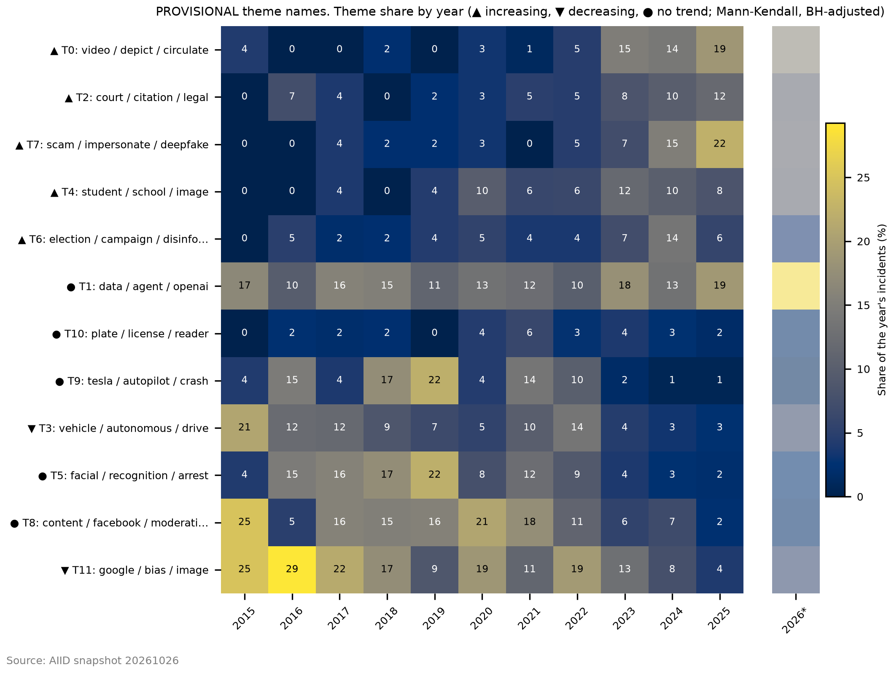
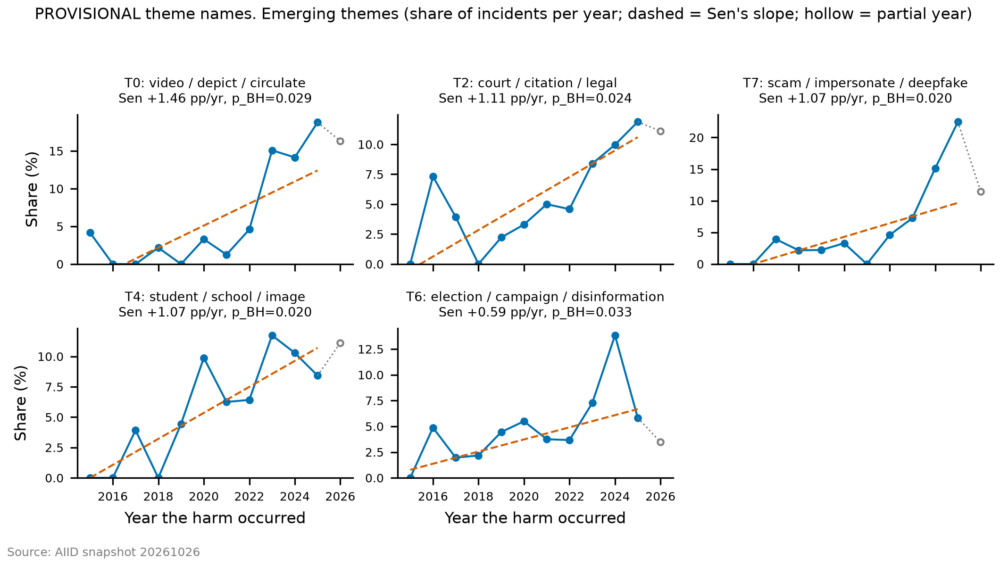
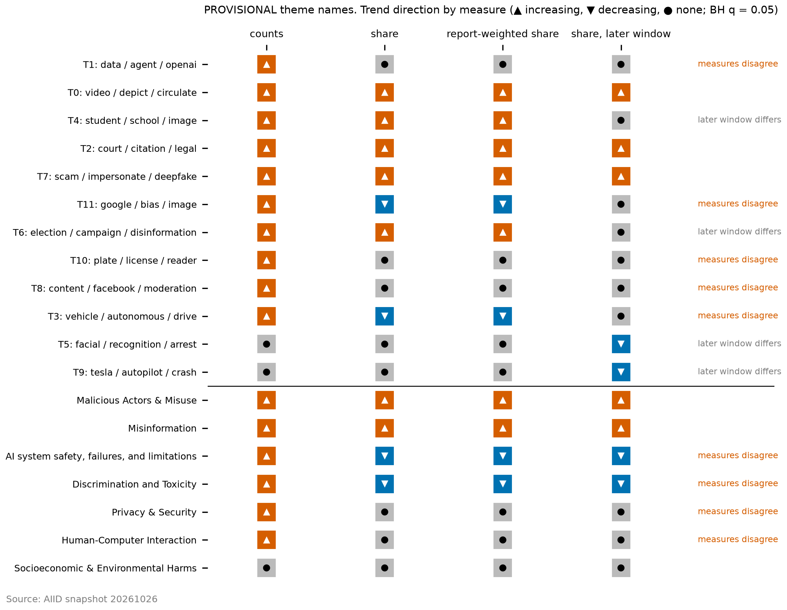
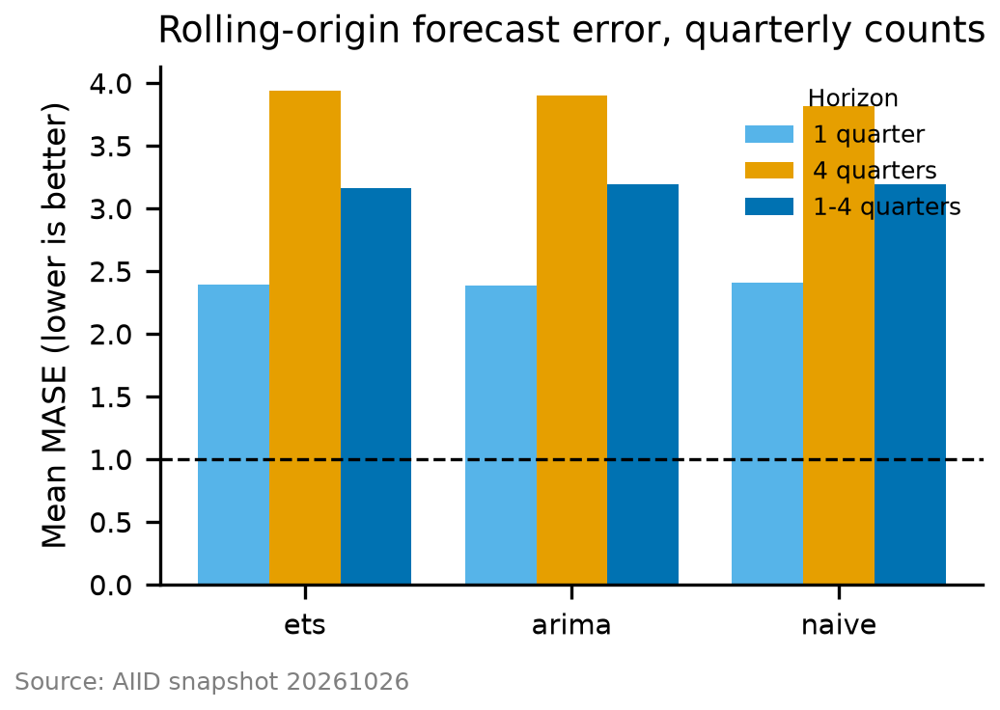

# RQ1b: trends over time (Phase 4)

> **PROVISIONAL.** Only 0 of 12 topic labels in `data/manual/topic_labels.csv` are confirmed, so themes carry the automatic placeholder names `T<id>: <first terms>`. The statistics depend only on which topic each incident belongs to, so they will not change when you add names; they **will** change if you merge topics (give two topics the same `final_label`) or if the topic model is re-fitted. Re-run `scripts/run_phase4_trends.py` after labelling.

_Auto-generated by `aicidentia.models.trend_outputs` (AIID snapshot **20261026**). Numbers are registered in `reports/results.json` under `rq1b.*`._

## Summary

- **Window:** complete years 2015-2025 (11 annual points; the partial year 2026, 288 incidents, is shown but never tested). Sensitivity window 2018-2025.
- **Emerging themes (primary measure: yearly share, BH-adjusted):** **T0: video / depict / circulate**, **T2: court / citation / legal**, **T7: scam / impersonate / deepfake**, **T4: student / school / image**, **T6: election / campaign / disinformation**. Significantly declining: T3: vehicle / autonomous / drive, T11: google / bias / image.
- **Counts overstate growth.** On raw counts 10 of 12 themes are 'increasing'; on shares 5; on report-weighted shares 5. Yearly incident counts rise steeply across the window, so a count-based test mostly detects database growth.
- **5 of 12 themes change classification depending on the measure** (counts vs share vs report-weighted share: the reporting-bias comparison; see section 3). A further 6 themes change when the window is shortened to 2018-2025, which mostly reflects lower power with 8 years.
- **MIT risk domains** (shares among MIT-labelled incidents): emerging: Malicious Actors & Misuse, Misinformation.
- **Forecasting is NOT justified on this evidence:** best model ets has mean MASE 3.16 vs 3.19 for the naive forecast (threshold for 'justified': at most 90% of naive).
- **OECD AIM replication:** not performed; `data/external/` is empty.

## 1. Method

- **Series.** For each theme and year: *count*; *share* = incidents of the theme / all incidents of that year; *report-weighted share* = reports on the theme's incidents / reports on all incidents (each incident weighted by its number of non-stub linked reports, a proxy for media attention). For MIT risk domains the denominator is MIT-labelled incidents only.
- **Test.** Mann-Kendall (pymannkendall `original_test`) with Sen's slope; Kendall's tau; a Theil-Sen 95% interval for the slope (scipy); the Hamed-Rao autocorrelation-corrected p-value as a robustness column.
- **Multiple testing.** Benjamini-Hochberg at q = 0.05 within each family (themes on one measure; domains on one measure). A series is *increasing*/*decreasing* if its BH-adjusted p is below q.
- **Emerging** = increasing (BH-significant, positive Sen slope) **and** the mean share of the last 2 complete years (2024-2025) above the long-run mean share over the window.
- **Slopes** are in percentage points of share per year (pp/yr).
- **Themes** come from the Phase 3 model (`NMF k=12|269da2dc16`), every incident assigned to its dominant topic; the topic model was fitted on all incidents, not only the test window.

## 2. Results: themes (primary measure = yearly share)

| group | tau | Sen slope (pp/yr) | 95% CI | p | p (BH) | p (Hamed-Rao) | long-run mean (%) | recent mean (%) | direction | emerging |
|---|---|---|---|---|---|---|---|---|---|---|
| T0: video / depict / circulate | 0.58 | 1.46 | [0.25, 2.71] | 0.0147 | 0.0293 | 0.0147 | 5.8 | 16.5 | increasing | YES |
| T2: court / citation / legal | 0.62 | 1.11 | [0.33, 1.68] | 0.01 | 0.0239 | 0.01 | 5.1 | 10.9 | increasing | YES |
| T7: scam / impersonate / deepfake | 0.69 | 1.07 | [0.56, 2.68] | 0.0036 | 0.0203 | 0.0036 | 5.5 | 18.8 | increasing | YES |
| T4: student / school / image | 0.69 | 1.07 | [0.54, 1.71] | 0.0036 | 0.0203 | 0.0036 | 5.6 | 9.4 | increasing | YES |
| T6: election / campaign / disinformation | 0.56 | 0.59 | [0.15, 1.18] | 0.0195 | 0.0335 | 0.0195 | 4.8 | 9.8 | increasing | YES |
| T1: data / agent / openai | 0.09 | 0.23 | [-0.70, 1.03] | 0.755 | 0.755 | 0.755 | 14 | 16.1 | no trend |  |
| T10: plate / license / reader | 0.22 | 0.16 | [-0.34, 0.76] | 0.39 | 0.426 | 0.39 | 2.6 | 2.2 | no trend |  |
| T9: tesla / autopilot / crash | -0.38 | -0.76 | [-3.15, 0.16] | 0.119 | 0.143 | 0.119 | 8.5 | 0.6 | no trend |  |
| T3: vehicle / autonomous / drive | -0.67 | -1.15 | [-2.03, -0.57] | 0.0051 | 0.0203 | 0.0051 | 9.1 | 2.9 | decreasing |  |
| T5: facial / recognition / arrest | -0.45 | -1.34 | [-2.59, 0.71] | 0.0617 | 0.0926 | 0.0617 | 10.2 | 2.4 | no trend |  |
| T8: content / facebook / moderation | -0.42 | -1.66 | [-2.88, 0.23] | 0.0868 | 0.116 | 0.0868 | 12.8 | 4.6 | no trend |  |
| T11: google / bias / image | -0.64 | -1.98 | [-3.60, -0.91] | 0.0081 | 0.0239 | 0.0081 | 16 | 5.9 | decreasing |  |

*Figure: Theme share by year, ordered by Sen slope (* = partial year, shown faded and never tested). Source: AIID snapshot 20261026.*

*Figure: Themes meeting the emerging definition. Source: AIID snapshot 20261026.*

## 3. Reporting-bias sensitivity: do conclusions depend on how we measure?

Each theme is classified under four measures. Raw counts mix real change with AIID's collection effort; shares remove overall growth; report-weighted shares add media attention. `agree` compares these first three (the reporting-bias question); `window_sensitive` flags themes whose share-based direction changes in the later window (2018-2025), a start-year check with only 8 points and therefore little power.

| theme | counts | share | report-weighted share | share, later window | agree | window_sensitive |
|---|---|---|---|---|---|---|
| T1: data / agent / openai | increasing | no trend | no trend | no trend | DISAGREE |  |
| T0: video / depict / circulate | increasing | increasing | increasing | increasing |  |  |
| T4: student / school / image | increasing | increasing | increasing | no trend |  | differs |
| T2: court / citation / legal | increasing | increasing | increasing | increasing |  |  |
| T7: scam / impersonate / deepfake | increasing | increasing | increasing | increasing |  |  |
| T11: google / bias / image | increasing | decreasing | decreasing | no trend | DISAGREE | differs |
| T6: election / campaign / disinformation | increasing | increasing | increasing | no trend |  | differs |
| T10: plate / license / reader | increasing | no trend | no trend | no trend | DISAGREE |  |
| T8: content / facebook / moderation | increasing | no trend | no trend | no trend | DISAGREE |  |
| T3: vehicle / autonomous / drive | increasing | decreasing | decreasing | no trend | DISAGREE | differs |
| T5: facial / recognition / arrest | no trend | no trend | no trend | decreasing |  | differs |
| T9: tesla / autopilot / crash | no trend | no trend | no trend | decreasing |  | differs |

*Figure: Trend direction of every theme and MIT domain under each measure. Source: AIID snapshot 20261026.*

### Where the measures disagree

5 theme(s) are classified differently across measures: **T1: data / agent / openai**; **T11: google / bias / image**; **T10: plate / license / reader**; **T8: content / facebook / moderation**; **T3: vehicle / autonomous / drive**. For these, the substantive conclusion depends on whether growth in database volume or in media attention is treated as part of the phenomenon; the share-based result is the primary one because it removes overall growth.

### Reports per incident by incident year (why report-weighting is itself biased)

| year | mean_reports | median_reports | incidents |
|---|---|---|---|
| 2015 | 10.1 | 6.5 | 24 |
| 2016 | 10.5 | 5 | 41 |
| 2017 | 7.57 | 4 | 51 |
| 2018 | 5.41 | 2.5 | 46 |
| 2019 | 3.18 | 3 | 45 |
| 2020 | 3.23 | 2 | 91 |
| 2021 | 3.48 | 2 | 80 |
| 2022 | 4.4 | 3 | 109 |
| 2023 | 4.86 | 2 | 179 |
| 2024 | 3.45 | 2 | 311 |
| 2025 | 3.03 | 2 | 463 |
| 2026 | 2.5 | 2 | 288 |

Incidents from 2025 have on average 3.03 linked reports against 10.12 for 2015. Recent incidents have had less time to attract coverage, so **report-weighted shares understate recent themes**; the weighting measures attention accumulated so far, not attention at the time. Use it only as a sensitivity check.

## 4. Results: MIT risk domains (shares among MIT-labelled incidents)

MIT labels are missing for some incidents, increasingly so for recent ones (labelled share: 88.6% in 2025, 34.7% in the partial 2026); shares use labelled incidents as the denominator, so a trend can partly reflect *which* incidents received a label.

| group | tau | Sen slope (pp/yr) | 95% CI | p | p (BH) | p (Hamed-Rao) | long-run mean (%) | recent mean (%) | direction | emerging |
|---|---|---|---|---|---|---|---|---|---|---|
| Malicious Actors & Misuse | 0.75 | 4.95 | [1.53, 7.94] | 0.0018 | 0.0065 | 0.0018 | 21.1 | 55.4 | increasing | YES |
| Misinformation | 0.76 | 1.88 | [0.84, 2.62] | 0.0014 | 0.0065 | 0.0014 | 7.9 | 16.8 | increasing | YES |
| Human-Computer Interaction | 0.25 | 0.17 | [-0.31, 0.79] | 0.306 | 0.306 | 0.306 | 2.7 | 2.9 | no trend |  |
| Socioeconomic & Environmental Harms | -0.49 | -0.35 | [-0.61, -0.02] | 0.043 | 0.0601 | 0.043 | 2.1 | 0.9 | no trend |  |
| Privacy & Security | -0.27 | -0.67 | [-1.59, 0.39] | 0.276 | 0.306 | 0.276 | 8.9 | 5.8 | no trend |  |
| Discrimination and Toxicity | -0.6 | -3.25 | [-4.18, -0.89] | 0.0127 | 0.0223 | 0.0127 | 25.3 | 8.2 | decreasing |  |
| AI system safety, failures, and limitations | -0.64 | -3.62 | [-5.69, -1.50] | 0.0081 | 0.019 | 0.0081 | 32 | 10 | decreasing |  |

Direction under each measure:

| domain | counts | share | report-weighted share | share, later window | agree | window_sensitive |
|---|---|---|---|---|---|---|
| Malicious Actors & Misuse | increasing | increasing | increasing | increasing |  | False |
| Misinformation | increasing | increasing | increasing | increasing |  | False |
| AI system safety, failures, and limitations | increasing | decreasing | decreasing | decreasing | DISAGREE | False |
| Discrimination and Toxicity | increasing | decreasing | decreasing | decreasing | DISAGREE | False |
| Privacy & Security | increasing | no trend | no trend | no trend | DISAGREE | False |
| Human-Computer Interaction | increasing | no trend | no trend | no trend | DISAGREE | False |
| Socioeconomic & Environmental Harms | no trend | no trend | no trend | no trend |  | False |

## 5. Forecasting quarterly counts

Quarterly counts 2015Q1-2025Q4 (44 quarters) for the total and every theme; rolling origin from 24 quarters, horizon 1-4 quarters. Models: naive (last value), exponential smoothing (better by AICc of simple and damped-trend ETS), ARIMA (order chosen by AICc from a small grid). Metric: MASE, scaled by the in-sample one-step naive error, averaged over origins, horizons and series. No forecast beyond the last complete quarter is produced.

| model | mean_mase_all_horizons | median_mase_all_horizons | mean_mase_h1 | mean_mase_h4 | series_where_best | series_total |
|---|---|---|---|---|---|---|
| ets | 3.16 | 3.36 | 2.4 | 3.94 | 6 | 12 |
| arima | 3.19 | 3.37 | 2.39 | 3.9 | 2 | 12 |
| naive | 3.19 | 3.27 | 2.41 | 3.82 | 4 | 12 |

Not scored: T10: plate / license / reader (mean quarterly count 0.86 < 1.0).

**Reading:** every model has mean MASE above 1 (best: 3.16), because the series grow faster than any of these models extrapolate and the training-window naive error that scales MASE is small. The best non-naive model reaches 99% of the naive error, against the 90% threshold set for 'justified'. **Forecasting is not justified**: with 44 quarters of strongly growing, small counts, a naive forecast is as good as the fitted models, and publishing forecasts would imply accuracy that was not demonstrated.

*Figure: Rolling-origin forecast error (MASE) by model and horizon. Source: AIID snapshot 20261026.*

## 6. External replication (OECD AIM)

Not performed: no OECD AIM export is present in `data/external/`. If you add one, tell me its format and I will check whether the AIID trends replicate.

## 7. Limitations

- **Short series.** 11 annual points give the Mann-Kendall test little power: only strong monotone trends are detected, and a non-significant result is not evidence of stability. Benjamini-Hochberg across a dozen themes lowers power further.
- **Reporting bias is the main caveat.** AIID records incidents that were reported and editorially accepted; a rising share of a theme can reflect editorial focus, new submission channels or news cycles, not more harm.
- **Theme definitions are recent-weighted.** The topic model was fitted on all incidents, most of which are recent, so themes describe recent incidents best; older incidents are assigned to the nearest theme even if their real subject differs.
- **Hard assignment and shares.** Each incident has one dominant theme, and many sit between themes (Phase 3), so shares are shares of *dominant* assignment.
- **Shares are compositional.** If one theme grows, the others must shrink in share; a declining share does not mean fewer incidents (see the counts column in the classification table).
- **Label coverage.** MIT-domain trends use labelled incidents only, and coverage falls for recent years.
- **No causal interpretation.** Trends describe the database, not the prevalence of AI harm.

