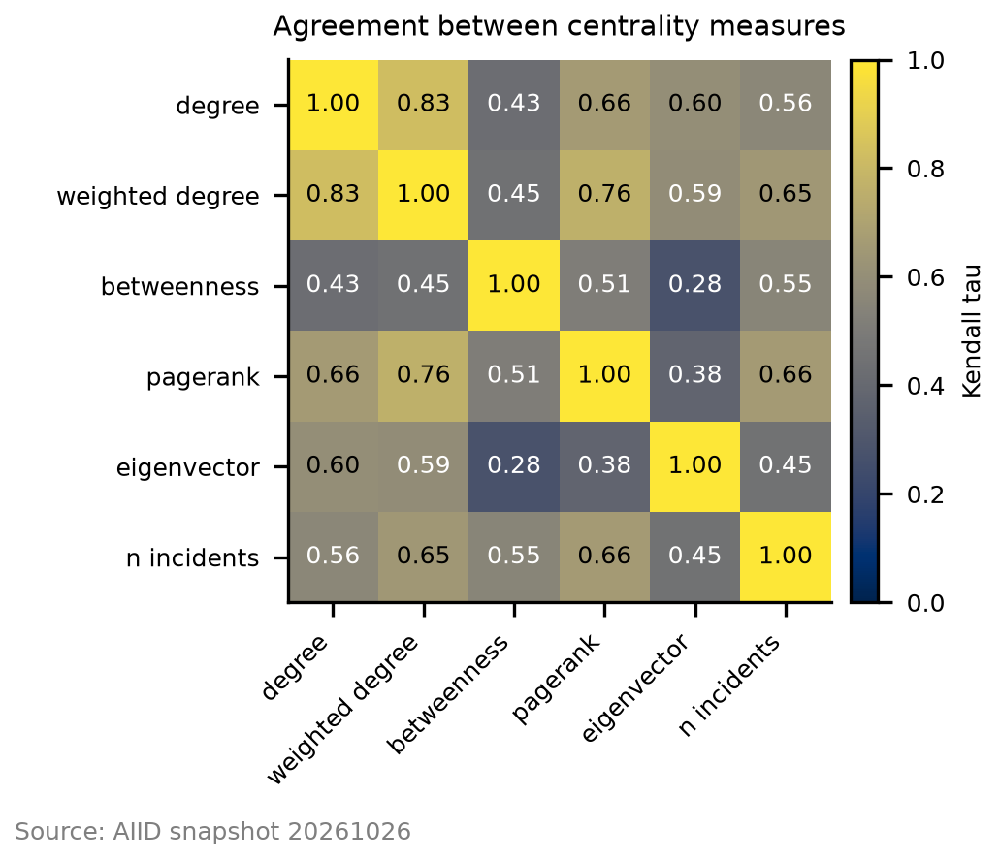
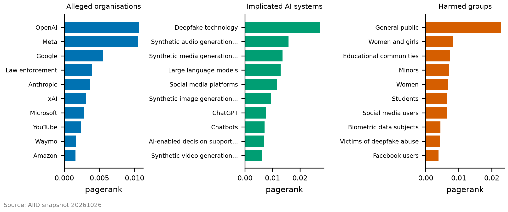
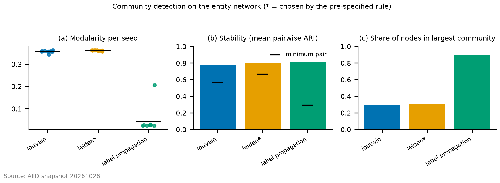
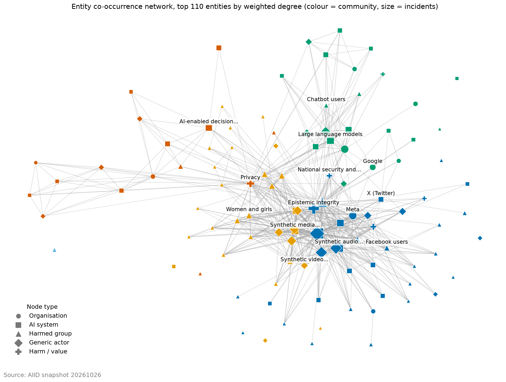
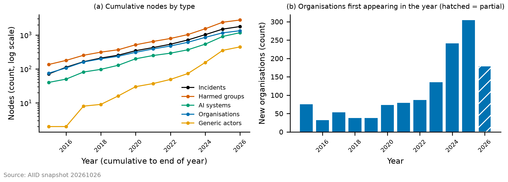
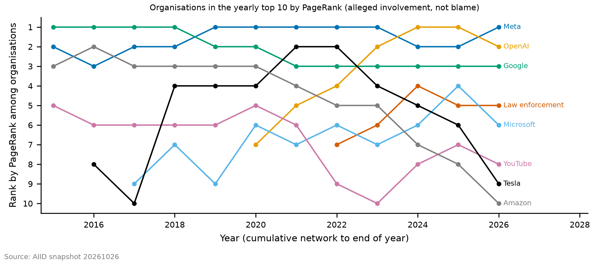

# RQ2: the incident network (Phase 5)

_Auto-generated by `aicidentia.models.network_outputs` (AIID snapshot **20261026**). Numbers are registered in `reports/results.json` under `rq2.*`. Organisations are **alleged** deployers and developers as AIID records them; centrality is frequency of involvement in reported incidents, never blame._

## Summary

- **Network:** 7,586 nodes and 17,782 edges in the typed incident graph (1,775 incidents, 1,335 organisations, 1,170 AI systems, 2,764 harmed groups, 7 risk domains, 18 sectors, plus generic actors and harm values). The entity co-occurrence network used for centrality and communities has 1,014 entities (those in at least 2 incidents) and 17,951 links.
- **Most central organisations (PageRank):** OpenAI, Meta, Google, Law enforcement, Anthropic; by weighted degree: Meta, OpenAI, Google, Law enforcement, Anthropic. The measures agree only moderately (Kendall tau between PageRank and weighted degree 0.76; lowest pair 0.28), so no single ranking should be quoted alone.
- **Communities:** leiden gives 11 communities (modularity 0.362; the largest holds 29% of entities). Louvain and Leiden are statistically indistinguishable on modularity (difference within seed noise), label propagation fails on this hub-heavy network (modularity 0.045, 89% of nodes in one community). Stability across 10 seeds is moderate (mean ARI 0.80, minimum 0.67), so I report the most representative run (seed 47).
- **Communities versus risk domains:** normalised mutual information 0.19: communities detected from entity ties alone are only weakly aligned with MIT risk domains.
- **Robustness:** removing the 28 hub entities present in more than 5% of incidents gives modularity 0.566 and a partition that agrees with the main one at mean ARI 0.32: **community boundaries depend heavily on the generic hubs**, so the communities below are one reading of a hub-dominated network, not stable structure.
- **Over time:** the median overlap between consecutive years' top-10 organisations is 82% (Jaccard).

## 1. Method

- **Heterogeneous graph.** Incident nodes are linked to entity nodes by the role the entity plays (alleged deployer, alleged developer, harmed party, implicated system; an entity with several roles in one incident gets one link with combined role), to one MIT risk-domain node, and to CSETv1 sector nodes. Node types come from the Phase 2 `entity_type`: organisation, AI system (`technology_system`), harmed group (`population_group`); generic actors and abstract harm values are kept as their own types so that they never pose as organisations or groups.
- **Exclusions.** Person-like entities (`individual_candidate`; 0 entity mentions) are left out: RQ2 concerns organisations, systems and groups, and unreviewed named individuals do not belong in a network. Every named person (rule D3, `data/manual/entity_review.csv`) is already removed in Phase 2.
- **Entity co-occurrence network.** Two entities are linked with weight = number of incidents they share (the one-mode projection). Entities in fewer than 2 incidents are dropped (they would be leaves hanging off other entities). Centrality and communities use this network; risk-domain and sector nodes are **not** part of community detection, so profiling communities by domain is not circular.
- **Centrality.** Degree (distinct co-occurring entities), weighted degree (total shared incidents), exact betweenness (igraph; link length = 1 / weight, so strong ties are short; exact, so no sampling needed), PageRank (damping 0.85) and eigenvector centrality (largest connected component). Agreement between measures: Kendall's tau.
- **Communities.** Louvain (networkx), Leiden (leidenalg, modularity) and asynchronous label propagation, each with 10 seeds. Modularity is computed identically for all. Rule fixed in advance: the highest mean modularity among methods whose mean pairwise adjusted Rand index (ARI) across seeds is at least 0.5.
- **Temporal evolution.** Cumulative snapshots at the end of each year (all entities, incidents up to that year): node and link growth by type, organisations first appearing in the year, and the top-10 organisations by PageRank in each cumulative network.

## 2. Network size

| node type | nodes |
|---|---|
| harmed_group | 2764 |
| incident | 1775 |
| organisation | 1335 |
| ai_system | 1170 |
| generic_actor | 446 |
| harm_value | 70 |
| sector | 18 |
| risk_domain | 7 |
| other | 1 |

Sectors exist only for the 200 incidents CSETv1 annotated, so sector findings are thin by construction.

## 3. Centrality

### Agreement between measures (all entities)

| index | degree | weighted_degree | betweenness | pagerank | eigenvector | n_incidents |
|---|---|---|---|---|---|---|
| degree | 1 | 0.83 | 0.43 | 0.66 | 0.6 | 0.56 |
| weighted_degree | 0.83 | 1 | 0.45 | 0.76 | 0.59 | 0.65 |
| betweenness | 0.43 | 0.45 | 1 | 0.51 | 0.28 | 0.55 |
| pagerank | 0.66 | 0.76 | 0.51 | 1 | 0.38 | 0.66 |
| eigenvector | 0.6 | 0.59 | 0.28 | 0.38 | 1 | 0.45 |
| n_incidents | 0.56 | 0.65 | 0.55 | 0.66 | 0.45 | 1 |

*Figure: Kendall's tau between centrality measures. Source: AIID snapshot 20261026.*

Organisations only: PageRank vs weighted degree tau = 0.68, betweenness vs eigenvector tau = 0.25. Betweenness picks out *bridging* entities (for example generic hubs such as the general public, or large language models) rather than the most frequently mentioned ones; eigenvector centrality is dominated by the dense deepfake cluster.

### Top 10 by pagerank

**Organisations** (alleged deployers/developers)

| alleged involvement: entity | incidents | degree | weighted_degree | betweenness | pagerank | eigenvector |
|---|---|---|---|---|---|---|
| OpenAI | 194 | 345 | 1298 | 41967 | 0.0107 | 0.0379 |
| Meta | 194 | 293 | 1518 | 19648 | 0.0105 | 0.123 |
| Google | 102 | 242 | 599 | 24965 | 0.0055 | 0.0205 |
| Law enforcement | 46 | 128 | 454 | 6372 | 0.0039 | 0.0137 |
| Anthropic | 42 | 160 | 419 | 1281 | 0.0037 | 0.0067 |
| xAI | 35 | 144 | 394 | 2908 | 0.0031 | 0.0173 |
| Microsoft | 46 | 140 | 285 | 7154 | 0.0028 | 0.007 |
| YouTube | 39 | 113 | 294 | 1100 | 0.0023 | 0.0272 |
| Waymo | 20 | 31 | 106 | 4058 | 0.0017 | 0.0007 |
| Amazon | 34 | 46 | 80 | 5131 | 0.0016 | 0.001 |

**Ai systems**

| alleged involvement: entity | incidents | degree | weighted_degree | betweenness | pagerank | eigenvector |
|---|---|---|---|---|---|---|
| Deepfake technology | 429 | 425 | 4220 | 33434 | 0.0273 | 0.402 |
| Synthetic audio generation technology | 250 | 333 | 2420 | 8187 | 0.0159 | 0.268 |
| Synthetic media generation technology | 141 | 293 | 2193 | 5354 | 0.0137 | 0.186 |
| Large language models | 164 | 337 | 1630 | 72101 | 0.0129 | 0.0477 |
| Social media platforms | 146 | 301 | 1812 | 5329 | 0.0116 | 0.162 |
| Synthetic image generation technology | 126 | 227 | 1483 | 91 | 0.0095 | 0.133 |
| ChatGPT | 115 | 256 | 979 | 3336 | 0.0077 | 0.028 |
| Chatbots | 82 | 213 | 960 | 507 | 0.0071 | 0.0303 |
| AI-enabled decision support systems | 120 | 195 | 621 | 29861 | 0.007 | 0.0152 |
| Synthetic video generation technology | 58 | 183 | 976 | 10 | 0.0061 | 0.0861 |

**Harmed groups**

| alleged involvement: entity | incidents | degree | weighted_degree | betweenness | pagerank | eigenvector |
|---|---|---|---|---|---|---|
| General public | 355 | 533 | 3048 | 102655 | 0.0228 | 0.225 |
| Women and girls | 97 | 216 | 1207 | 16530 | 0.0083 | 0.084 |
| Educational communities | 106 | 185 | 979 | 34996 | 0.0074 | 0.0603 |
| Minors | 100 | 199 | 987 | 6002 | 0.0071 | 0.063 |
| Women | 80 | 203 | 940 | 162 | 0.0067 | 0.0642 |
| Students | 98 | 153 | 852 | 527 | 0.0066 | 0.0546 |
| Social media users | 75 | 240 | 934 | 1158 | 0.0064 | 0.0718 |
| Biometric data subjects | 52 | 159 | 447 | 364 | 0.0045 | 0.0109 |
| Victims of deepfake abuse | 41 | 113 | 687 | 4 | 0.0042 | 0.06 |
| Facebook users | 69 | 134 | 547 | 1011 | 0.0039 | 0.0408 |

### Top 10 by weighted degree

**Organisations** (alleged deployers/developers)

| alleged involvement: entity | incidents | degree | weighted_degree | betweenness | pagerank | eigenvector |
|---|---|---|---|---|---|---|
| Meta | 194 | 293 | 1518 | 19648 | 0.0105 | 0.123 |
| OpenAI | 194 | 345 | 1298 | 41967 | 0.0107 | 0.0379 |
| Google | 102 | 242 | 599 | 24965 | 0.0055 | 0.0205 |
| Law enforcement | 46 | 128 | 454 | 6372 | 0.0039 | 0.0137 |
| Anthropic | 42 | 160 | 419 | 1281 | 0.0037 | 0.0067 |
| xAI | 35 | 144 | 394 | 2908 | 0.0031 | 0.0173 |
| YouTube | 39 | 113 | 294 | 1100 | 0.0023 | 0.0272 |
| Microsoft | 46 | 140 | 285 | 7154 | 0.0028 | 0.007 |
| Flock Safety | 16 | 27 | 185 | 2 | 0.0015 | 0.003 |
| Perplexity | 9 | 67 | 132 | 5 | 0.0011 | 0.0035 |

**Ai systems**

| alleged involvement: entity | incidents | degree | weighted_degree | betweenness | pagerank | eigenvector |
|---|---|---|---|---|---|---|
| Deepfake technology | 429 | 425 | 4220 | 33434 | 0.0273 | 0.402 |
| Synthetic audio generation technology | 250 | 333 | 2420 | 8187 | 0.0159 | 0.268 |
| Synthetic media generation technology | 141 | 293 | 2193 | 5354 | 0.0137 | 0.186 |
| Social media platforms | 146 | 301 | 1812 | 5329 | 0.0116 | 0.162 |
| Large language models | 164 | 337 | 1630 | 72101 | 0.0129 | 0.0477 |
| Synthetic image generation technology | 126 | 227 | 1483 | 91 | 0.0095 | 0.133 |
| ChatGPT | 115 | 256 | 979 | 3336 | 0.0077 | 0.028 |
| Synthetic video generation technology | 58 | 183 | 976 | 10 | 0.0061 | 0.0861 |
| Chatbots | 82 | 213 | 960 | 507 | 0.0071 | 0.0303 |
| AI-enabled decision support systems | 120 | 195 | 621 | 29861 | 0.007 | 0.0152 |

**Harmed groups**

| alleged involvement: entity | incidents | degree | weighted_degree | betweenness | pagerank | eigenvector |
|---|---|---|---|---|---|---|
| General public | 355 | 533 | 3048 | 102655 | 0.0228 | 0.225 |
| Women and girls | 97 | 216 | 1207 | 16530 | 0.0083 | 0.084 |
| Minors | 100 | 199 | 987 | 6002 | 0.0071 | 0.063 |
| Educational communities | 106 | 185 | 979 | 34996 | 0.0074 | 0.0603 |
| Women | 80 | 203 | 940 | 162 | 0.0067 | 0.0642 |
| Social media users | 75 | 240 | 934 | 1158 | 0.0064 | 0.0718 |
| Students | 98 | 153 | 852 | 527 | 0.0066 | 0.0546 |
| Victims of deepfake abuse | 41 | 113 | 687 | 4 | 0.0042 | 0.06 |
| Facebook users | 69 | 134 | 547 | 1011 | 0.0039 | 0.0408 |
| Chatbot users | 40 | 141 | 519 | 36 | 0.0038 | 0.0134 |

*Figure: Top 10 by PageRank per node type. Source: AIID snapshot 20261026.*

### Organisation x harmed-group projection (top 15 links)

Weight = incidents in which the organisation is an alleged deployer or developer and the group is a harmed party.

| organisation (alleged) | harmed group | weight |
|---|---|---|
| Meta | Facebook users | 40 |
| OpenAI | General public | 38 |
| OpenAI | ChatGPT users | 29 |
| Meta | General public | 22 |
| Tesla | Tesla drivers | 22 |
| Google | General public | 21 |
| xAI | General public | 18 |
| OpenAI | Educational communities | 17 |
| OpenAI | Chatbot users | 17 |
| OpenAI | Students | 14 |
| Meta | Instagram users | 14 |
| Meta | Meta users | 14 |
| Law enforcement | General public | 11 |
| Google | Women and girls | 11 |
| OpenAI | Minors | 10 |

## 4. Communities

| method | modularity_mean | modularity_sd | n_communities_mean | largest_share_mean | singletons_mean | stability_ari_mean | stability_ari_min |
|---|---|---|---|---|---|---|---|
| louvain | 0.357 | 0.005 | 10.2 | 0.288 | 2 | 0.776 | 0.564 |
| leiden | 0.361 | 0.002 | 10.4 | 0.307 | 2 | 0.796 | 0.665 |
| label_propagation | 0.045 | 0.057 | 14.9 | 0.894 | 2 | 0.815 | 0.291 |

*Figure: Community detection methods compared. Source: AIID snapshot 20261026.*

**Rule outcome:** leiden (highest mean modularity among methods with mean ARI >= 0.5). This is a near tie: leiden and louvain differ in mean modularity by less than one seed standard deviation, and louvain is less stable (mean ARI 0.78 vs 0.80); either would support the same conclusions.

### Community profiles (most representative run, seed 47)

Incidents are assigned to the community that holds most of their entities. Domains and sectors describe those incidents; they were not used to form the communities. The domain mix is not shown for communities with fewer than 20 incidents, because it would reveal the labels of individual incidents.

| community | entities | incidents | organisations | ai_systems | harmed_groups | domains | sectors |
|---|---|---|---|---|---|---|---|
| 0 | 293 | 454 | OpenAI; Google; Microsoft; Anthropic | Large language models; ChatGPT; Chatbots; AI agent systems | Chatbot users; ChatGPT users; Emotionally vulnerable individuals; Companies | Misinformation (27%); Malicious Actors & Misuse (20%); Discrimination and Toxicity (18%) | information and communication (32); Arts, entertainment and recreation (11); transportation and storage (4) |
| 1 | 282 | 633 | Meta; YouTube; Twitter; Storm-1516 | Deepfake technology; Synthetic audio generation technology; Social media platforms; X (Twitter) | General public; Social media users; Facebook users; X (Twitter) users | Malicious Actors & Misuse (68%); Misinformation (14%); Discrimination and Toxicity (10%) | information and communication (24); Arts, entertainment and recreation (10); wholesale and retail trade (2) |
| 2 | 194 | 276 | Law enforcement; Amazon; Flock Safety; Clearview AI | AI-enabled decision support systems; Enterprise AI systems; Facial recognition systems; Surveillance technology | Biometric data subjects; Minority groups; General public of the United States; Patients | AI system safety, failures, and limitations (33%); Discrimination and Toxicity (29%); Privacy & Security (17%) | information and communication (16); law enforcement (12); wholesale and retail trade (11) |
| 3 | 145 | 198 | Apple; ElevenLabs; Universities; Knightscope | Synthetic media generation technology; Synthetic image generation technology; Synthetic video generation technology; AI nudification tools | Educational communities; Minors; Students; Women and girls | Malicious Actors & Misuse (48%); AI system safety, failures, and limitations (21%); Discrimination and Toxicity (17%) | Education (11); information and communication (5); administrative and support service activities (3) |
| 4 | 58 | 101 | Tesla; Waymo; Cruise; Baidu | Automated driving systems; Automated driving system deployers; Waymo's autonomous driving system; Robotaxi systems | Road users; Tesla drivers; Drivers; Pedestrians | AI system safety, failures, and limitations (93%); Human-Computer Interaction (6%); Misinformation (1%) | transportation and storage (11); manufacturing (1) |
| 5 | 24 | 15 | Stability AI; LAION; EleutherAI; CompVis LMU | Music streaming services; Spotify; Stable Diffusion | Musicians; Songwriters; Universal Music Group; artists | (not shown: fewer than 20 incidents) | information and communication (1); Arts, entertainment and recreation (1) |
| 6 | 10 | 3 |  | Data centers; Energy infrastructure; Unpermitted energy infrastructure; Methane gas turbines | General public of Tennessee; Environmental quality; Public health; Predominantly Black communities | (not shown: fewer than 20 incidents) |  |
| 7 | 4 | 2 | Nomi AI | Nomi; Nomi chatbots | Nomi users | (not shown: fewer than 20 incidents) |  |
| 8 | 2 | 2 | Lockheed Martin; Raytheon |  |  | (not shown: fewer than 20 incidents) |  |
| 9 | 1 | 4 |  | Starship Technologies |  | (not shown: fewer than 20 incidents) | accommodation and food service activities (1); transportation and storage (1) |
| 10 | 1 | 2 | UserWay |  |  | (not shown: fewer than 20 incidents) | information and communication (1) |

*Figure: Entity co-occurrence network (top entities by weighted degree). Source: AIID snapshot 20261026.*

### Robustness: removing hub entities

Entities appearing in more than 5% of incidents (89+) are generic hubs that connect almost everything: AI-enabled decision support systems, ChatGPT, Deepfake creators, Deepfake technology, Deepfake technology developers, Democratic integrity, Educational communities, Epistemic integrity, General public, Google, Large language model developers, Large language models ... (28 entities). Re-running leiden without them gives modularity 0.566 on 977 entities and agrees with the main partition at mean ARI 0.32 (minimum 0.28).

## 5. Temporal evolution

| year | nodes | edges | new_organisations | organisations |
|---|---|---|---|---|
| 2015 | 347 | 474 | 75 | 75 |
| 2016 | 474 | 681 | 32 | 107 |
| 2017 | 691 | 1021 | 53 | 160 |
| 2018 | 853 | 1290 | 38 | 198 |
| 2019 | 1029 | 1599 | 38 | 236 |
| 2020 | 1430 | 2304 | 73 | 309 |
| 2021 | 1780 | 2894 | 79 | 388 |
| 2022 | 2175 | 3591 | 87 | 475 |
| 2023 | 2837 | 5046 | 135 | 610 |
| 2024 | 4155 | 8010 | 241 | 851 |
| 2025 | 6361 | 13622 | 304 | 1155 |
| 2026 | 7586 | 17782 | 180 | 1335 |

*Figure: Network growth and new organisations per year. Source: AIID snapshot 20261026.*

Years to 2025 are complete; 2026 is partial. New organisations per year largely follow incident volume, so growth in the network is mostly growth in coverage, not in structure.

### Top-10 organisations by PageRank over time

| organisation | 2015 | 2016 | 2017 | 2018 | 2019 | 2020 | 2021 | 2022 | 2023 | 2024 | 2025 | 2026 |
|---|---|---|---|---|---|---|---|---|---|---|---|---|
| Amazon | 3 | 2 | 3 | 3 | 3 | 3 | 4 | 5 | 5 | 7 | 8 | 10 |
| Meta | 2 | 3 | 2 | 2 | 1 | 1 | 1 | 1 | 1 | 2 | 2 | 1 |
| YouTube | 5 | 6 | 6 | 6 | 6 | 5 | 6 | 9 | 10 | 8 | 7 | 8 |
| Google | 1 | 1 | 1 | 1 | 2 | 2 | 3 | 3 | 3 | 3 | 3 | 3 |
| Tesla |  | 8 | 10 | 4 | 4 | 4 | 2 | 2 | 4 | 5 | 6 | 9 |
| Microsoft |  |  | 9 | 7 | 9 | 6 | 7 | 6 | 7 | 6 | 4 | 6 |
| Apple |  |  | 5 | 8 | 5 | 8 | 8 | 8 | 8 | 9 |  |  |
| OpenAI |  |  |  |  |  | 7 | 5 | 4 | 2 | 1 | 1 | 2 |
| Chicago Police Department | 4 | 4 | 4 | 5 | 7 | 10 |  |  |  |  |  |  |
| Uber | 9 | 7 | 8 | 9 | 10 |  |  |  |  |  |  |  |
| Law enforcement |  |  |  |  |  |  |  | 7 | 6 | 4 | 5 | 5 |
| ShotSpotter | 6 | 5 | 7 | 10 |  |  |  |  |  |  |  |  |
| Anthropic |  |  |  |  |  |  |  |  |  |  | 9 | 4 |
| Clearview AI |  |  |  |  |  | 9 | 10 |  |  |  |  |  |
| Lockheed Martin | 8 | 10 |  |  |  |  |  |  |  |  |  |  |
| Huawei |  |  |  |  | 8 |  | 9 |  |  |  |  |  |
| Cruise |  |  |  |  |  |  |  | 10 | 9 |  |  |  |
| xAI |  |  |  |  |  |  |  |  |  |  | 10 | 7 |
| Raytheon | 7 | 9 |  |  |  |  |  |  |  |  |  |  |
| Flock Safety |  |  |  |  |  |  |  |  |  | 10 |  |  |
| UK Home Office | 10 |  |  |  |  |  |  |  |  |  |  |  |

| year | previous | jaccard_with_previous | entered |
|---|---|---|---|
| 2016 | 2015 | 0.82 | 1 |
| 2017 | 2016 | 0.67 | 2 |
| 2018 | 2017 | 1 | 0 |
| 2019 | 2018 | 0.82 | 1 |
| 2020 | 2019 | 0.67 | 2 |
| 2021 | 2020 | 0.82 | 1 |
| 2022 | 2021 | 0.67 | 2 |
| 2023 | 2022 | 1 | 0 |
| 2024 | 2023 | 0.82 | 1 |
| 2025 | 2024 | 0.67 | 2 |
| 2026 | 2025 | 1 | 0 |

*Figure: Rank of organisations in the yearly top 10 by PageRank. Source: AIID snapshot 20261026.*

## 6. Dashboard export

`reports/network_graph.json`: 127 nodes and 900 edges (top 150 entities by weighted degree, at most 900 strongest links; 344 kB). Each link carries per-year counts and each node its first and last year, so a year slider can show the cumulative network by summing counts up to the chosen year. Nodes carry a profile (risk-domain mix, up to five recent incidents) for the click panel, and the file states the *alleged involvement* caveat.

## 7. Limitations

- **Alleged involvement, not responsibility.** AIID records alleged developers and deployers; a central organisation is one named often, which also reflects what the media cover and what editors record.
- **Entity types are heuristic** (Phase 2). Class-level groups such as law enforcement are typed as organisations; some generic entities are hubs. Treat type-specific rankings as indicative.
- **Hubs and projection.** Projecting incidents onto entities turns every incident into a clique, so incidents naming many entities (up to dozens) inflate degrees and create dense blocks; weighted measures and the hub-removal check mitigate but do not remove this.
- **Modularity limits.** Modularity has a resolution limit and the partitions are only moderately stable across seeds; communities are descriptive groupings, not natural kinds.
- **Coverage.** Sector nodes exist for 200 incidents; risk-domain nodes only for MIT-labelled incidents (machine-generated labels).
- **Cumulative snapshots use the harm date**; late additions of old incidents change early years' networks retrospectively.
- **Person-like entities were excluded**, which removes public figures who are frequent deepfake targets from the harmed-group picture; this is deliberate, pending your entity review.

