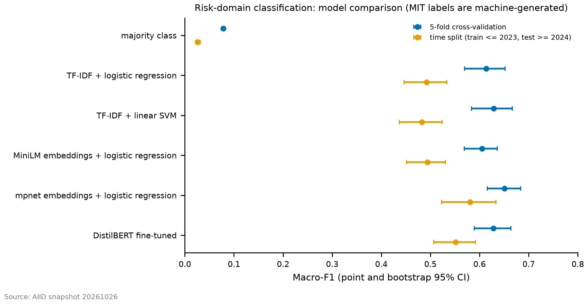
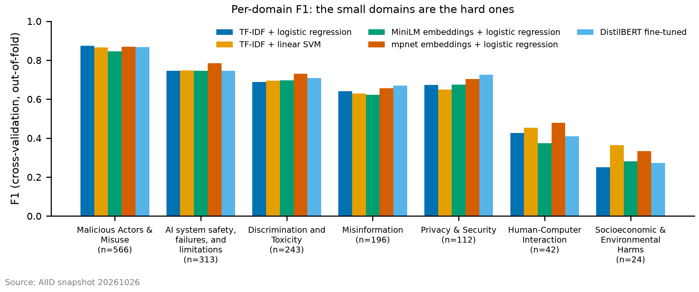
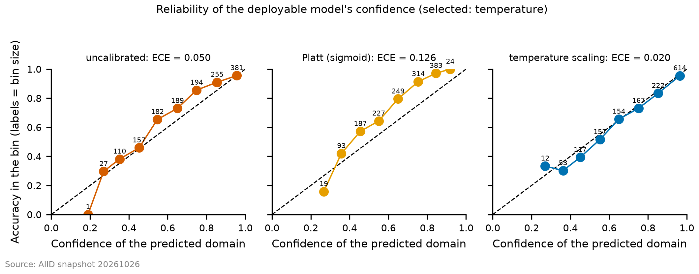
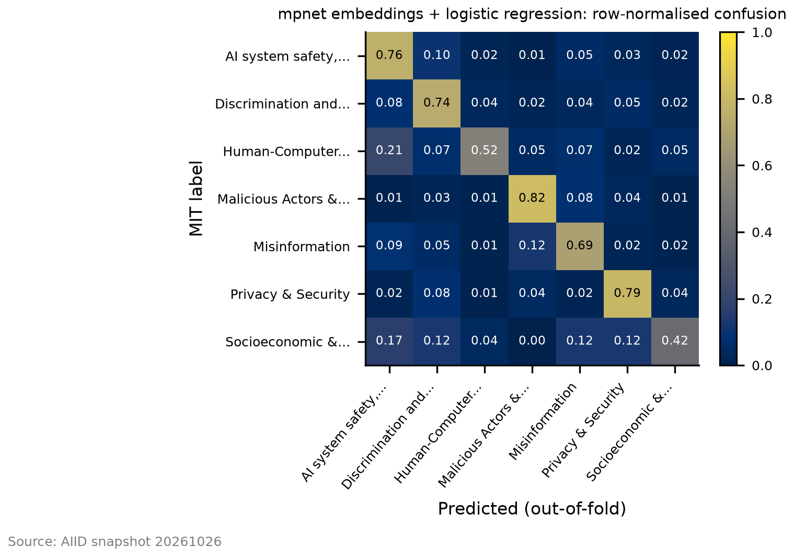

# RQ3: risk-domain classification and label reliability (Phase 6)

_Auto-generated by `aicidentia.models.classify_outputs` (AIID snapshot **20261026**). Numbers are registered in `reports/results.json` under `rq3.*`._

> **Read this first.** The target (MIT Risk Domain) is a *machine-generated* label. Classifier accuracy below measures how well the incident text reproduces that automatic labeller; it says nothing about agreement with human judgement. That second question is answered with independent signals already in AIID (section 5).

## Summary

- **Data:** 1,496 MIT-labelled incidents, 7 classes (largest 37.8%, smallest 24); input is title + description. A majority-class model scores macro-F1 0.078 (accuracy 37.8%).
- **Best cross-validated model: mpnet embeddings + logistic regression**, macro-F1 0.651 [0.616, 0.684] (pooled out-of-fold, bootstrap 95% CI), accuracy 76.3%. TF-IDF + logistic regression: 0.614 [0.570, 0.652]. The five local models span 0.605 to 0.651; only 1 of 5 paired comparisons with TF-IDF + logistic regression reach p < 0.05, so most differences between the real models are within noise.
- **DistilBERT (fine-tuned on the local GPU; Colab notebook as alternative):** macro-F1 0.628 [0.590, 0.664]; see section 2 for how it compares.
- **Time split (train <= 2023, test >= 2024; 694 / 802 incidents):** the best model scores 0.581 [0.523, 0.634] against 0.651 [0.616, 0.684] in cross-validation (lower by 0.070; this mixes distribution shift with a smaller training set, 694 incidents against about 1,197 per fold).
- **Deployable model: mpnet embeddings + logistic regression**, confidence method: temperature. Expected calibration error: uncalibrated 0.050, Platt 0.126, temperature scaling 0.020. Saved to `models/rq3_domain_classifier.joblib` (git-ignored); predictions for every incident are in `data/processed/rq3_domain_predictions.parquet`.

## 1. Method

- **Target and input.** MIT Risk Domain (7 classes) as agreed in Phase 1 (docs/data_audit.md, D1); input = `text` (title + description).
- **Splits.** Stratified 5-fold cross-validation with folds fixed once (seed 42, saved in `reports/colab/rq3_colab_input.csv` so the DistilBERT run uses identical folds), and a time split (train before 2024: 694; test from 2024: 802). The time-split test set contains only labelled incidents.
- **Models.** Majority class; TF-IDF (1-2-grams, min_df 2, sublinear) + logistic regression; TF-IDF + linear SVM; frozen sentence embeddings (all-MiniLM-L6-v2, all-mpnet-base-v2) + logistic regression; DistilBERT fine-tuned on the local GPU (same protocol as the Colab notebook). `class_weight="balanced"` everywhere it exists (DistilBERT uses the equivalent class-weighted loss).
- **Tuning without leakage.** The regularisation strength is chosen by an inner 3-fold CV (macro-F1) inside each training part, so no test fold influences any choice (nested CV). DistilBERT's hyperparameters were fixed in advance.
- **Metrics.** Macro-F1 is primary (the classes are very unequal), with weighted-F1, accuracy and per-class precision/recall/F1. Confidence intervals are percentile bootstrap (resampling incidents, 1000 draws) of the pooled out-of-fold predictions. Paired comparisons use the paired bootstrap of the macro-F1 difference and the exact McNemar test on correctness.
- **Deployable-model rule (fixed in advance).** The local model with the best cross-validated macro-F1, unless its paired advantage over TF-IDF + LR is not significant, in which case TF-IDF + LR (no model download, works offline).

## 2. Results

| model | setting | n | macro-F1 [95% CI] | weighted-F1 | accuracy | per-fold macro-F1 (mean ± sd) |
|---|---|---|---|---|---|---|
| majority class | cv | 1496 | 0.078 [0.075, 0.082] | 0.208 | 37.8% | 0.078 ± 0.000 |
| majority class | time | 802 | 0.027 [0.022, 0.031] | 0.019 | 10.2% |  |
| TF-IDF + logistic regression | cv | 1496 | 0.614 [0.570, 0.652] | 0.748 | 75.0% | 0.611 ± 0.041 |
| TF-IDF + logistic regression | time | 802 | 0.492 [0.446, 0.533] | 0.716 | 72.4% |  |
| TF-IDF + linear SVM | cv | 1496 | 0.629 [0.584, 0.667] | 0.746 | 75.1% | 0.628 ± 0.021 |
| TF-IDF + linear SVM | time | 802 | 0.483 [0.437, 0.524] | 0.715 | 72.3% |  |
| MiniLM embeddings + logistic regression | cv | 1496 | 0.605 [0.569, 0.636] | 0.736 | 72.6% | 0.606 ± 0.023 |
| MiniLM embeddings + logistic regression | time | 802 | 0.494 [0.451, 0.531] | 0.697 | 70.1% |  |
| mpnet embeddings + logistic regression | cv | 1496 | 0.651 [0.616, 0.684] | 0.769 | 76.3% | 0.649 ± 0.042 |
| mpnet embeddings + logistic regression | time | 802 | 0.581 [0.523, 0.634] | 0.746 | 74.4% |  |
| DistilBERT fine-tuned | cv | 1496 | 0.628 [0.590, 0.664] | 0.757 | 75.5% | 0.627 ± 0.040 |
| DistilBERT fine-tuned | time | 802 | 0.551 [0.507, 0.592] | 0.746 | 75.7% |  |

*Figure: Macro-F1 by model with bootstrap 95% CI. Source: AIID snapshot 20261026.*

### Paired comparisons

Difference in macro-F1 (model A minus model B) on identical incidents; p-values from the paired bootstrap and the exact McNemar test.

| model_a | model_b | setting | difference [95% CI] | p (bootstrap) | p (McNemar) |
|---|---|---|---|---|---|
| majority class | TF-IDF + logistic regression | cv | -0.535 [-0.574, -0.491] | 0.001 | 0 |
| majority class | TF-IDF + logistic regression | time | -0.466 [-0.507, -0.420] | 0.001 | 0 |
| TF-IDF + linear SVM | TF-IDF + logistic regression | cv | +0.015 [-0.007, +0.038] | 0.222 | 1 |
| TF-IDF + linear SVM | TF-IDF + logistic regression | time | -0.009 [-0.030, +0.009] | 0.382 | 1 |
| MiniLM embeddings + logistic regression | TF-IDF + logistic regression | cv | -0.008 [-0.045, +0.029] | 0.714 | 0.0304 |
| MiniLM embeddings + logistic regression | TF-IDF + logistic regression | time | +0.002 [-0.046, +0.048] | 0.928 | 0.145 |
| mpnet embeddings + logistic regression | TF-IDF + logistic regression | cv | +0.037 [+0.003, +0.074] | 0.04 | 0.256 |
| mpnet embeddings + logistic regression | TF-IDF + logistic regression | time | +0.089 [+0.028, +0.151] | 0.001 | 0.258 |
| TF-IDF + LR, text + first report words (ablation) | TF-IDF + logistic regression | cv | -0.012 [-0.042, +0.014] | 0.408 | 0.835 |
| TF-IDF + LR, text + first report words (ablation) | TF-IDF + logistic regression | time | -0.003 [-0.049, +0.043] | 0.918 | 0.0755 |
| DistilBERT fine-tuned | TF-IDF + logistic regression | cv | +0.015 [-0.020, +0.048] | 0.386 | 0.649 |
| DistilBERT fine-tuned | TF-IDF + logistic regression | time | +0.059 [+0.014, +0.104] | 0.012 | 0.0304 |
| mpnet embeddings + logistic regression | majority class | cv | +0.572 [+0.537, +0.606] | 0.001 | 0 |
| mpnet embeddings + logistic regression | majority class | time | +0.554 [+0.497, +0.606] | 0.001 | 0 |

**DistilBERT vs TF-IDF + logistic regression:** difference +0.015 (95% CI [-0.020, +0.048]): the fine-tuned model does not beat the baseline at the 5% level.

### Per-domain results (out-of-fold)

| index | DistilBERT fine-tuned | MiniLM embeddings + logistic regression | TF-IDF + linear SVM | TF-IDF + logistic regression | mpnet embeddings + logistic regression |
|---|---|---|---|---|---|
| Malicious Actors & Misuse | 0.867 | 0.845 | 0.866 | 0.873 | 0.869 |
| AI system safety, failures, and limitations | 0.745 | 0.745 | 0.747 | 0.746 | 0.785 |
| Discrimination and Toxicity | 0.708 | 0.697 | 0.695 | 0.688 | 0.73 |
| Misinformation | 0.67 | 0.622 | 0.629 | 0.64 | 0.655 |
| Privacy & Security | 0.726 | 0.674 | 0.649 | 0.672 | 0.704 |
| Human-Computer Interaction | 0.41 | 0.374 | 0.453 | 0.427 | 0.478 |
| Socioeconomic & Environmental Harms | 0.273 | 0.281 | 0.364 | 0.25 | 0.333 |

*Figure: Per-domain F1 by model. Source: AIID snapshot 20261026.*

The two smallest domains (Human-Computer Interaction, Socioeconomic & Environmental Harms; 42 and 24 incidents) are far harder than the large ones, and with about five test cases of the smallest class per fold their scores are very uncertain; the pooled out-of-fold numbers use all of them but remain noisy.

### Ablation: adding report text

Appending the first 256 words of each incident's longest linked report to the text gives macro-F1 0.602 [0.562, 0.638] against 0.614 [0.570, 0.652] for title + description alone (same model, same folds). Longer text does not clearly help. Only the TF-IDF model was tried; the embedding models truncate long input anyway.

## 3. Deployable model and calibration

**mpnet embeddings + logistic regression.** Highest cross-validated macro-F1 and significantly better than TF-IDF + logistic regression (difference +0.037, 95% CI [+0.003, +0.074]).

*Caveat:* the lower end of that interval is only +0.003 and the exact McNemar test on accuracy is not significant (p = 0.26), so the advantage is borderline in cross-validation; it is clearer in the time split. The cost of choosing it is that inference needs the sentence-embedding model (a one-off download, then cached locally; the dashboard must be run with that cache present to work offline).

### Calibration of the confidence shown to users

| index | uncalibrated | Platt (sigmoid) | temperature scaling |
|---|---|---|---|
| expected calibration error (10 bins) | 0.05 | 0.126 | 0.02 |
| Brier score | 0.343 | 0.337 | 0.335 |
| accuracy | 0.763 | 0.786 | 0.763 |
| mean confidence | 0.713 | 0.663 | 0.781 |
| macro-F1 | 0.651 | 0.669 | 0.651 |

All options are evaluated on out-of-fold predictions with calibration fitted inside each training part (inner 3-fold CV), so no test fold influences them. The uncalibrated model is slightly under-confident (mean confidence 0.713 vs accuracy 0.763). Platt scaling (one-vs-rest sigmoids renormalised over seven classes) worsens ECE (0.050 -> 0.126); temperature scaling (one parameter, fitted T = 0.75 for the final model if selected) gives 0.020. Rule fixed in advance: keep the uncalibrated model unless a calibrator lowers ECE by more than 0.005. **Selected: temperature scaling.** Temperature scaling does not change the predicted class, so macro-F1 is unchanged.

*Figure: Reliability of the predicted domain's confidence for each calibration option. Source: AIID snapshot 20261026.*

## 4. Error analysis

Row-normalised confusion matrix of the best cross-validated model (mpnet embeddings + logistic regression); rows are the MIT label.

*Figure: Confusion matrix (out-of-fold). Source: AIID snapshot 20261026.*

### Most frequent confusions (deployable model, calibrated confidence), with the most confidently wrong examples

| true_domain | predicted_as | count | share_of_true_class | examples |
|---|---|---|---|---|
| Malicious Actors & Misuse | Misinformation | 47 | 0.083 | #867: AI-Generated Airline Reviews Allegedly Mislead Consumers and Undermine Trust \|\| #1042: Fact-Checking Finds Reportedly AI-Generated Video Misattributed Hypertension Cure Endorsements to Taiwo Ajai-Lycett and Chinonso Egemba \|\| #1323: Madhya Pradesh Congress Alleges AI-Generated Images Were Submitted in National Water Award Process |
| AI system safety, failures, and limitations | Discrimination and Toxicity | 32 | 0.102 | #144: YouTube's AI Mistakenly Banned Chess Channel over Chess Language Misinterpretation \|\| #233: Tumblr Automated Pornography-Detecting Algorithms Erroneously Flagged Inoffensive Images as Explicit \|\| #172: NarxCare’s Risk Score Model Allegedly Lacked Validation and Trained on Data with High Risk of Bias |
| Misinformation | Malicious Actors & Misuse | 24 | 0.122 | #202: Korean Politician Employed Deepfake as Campaign Representative \|\| #1005: Misleading Deepfake Video of Trump Mocking Zelenskyy for Clothing Goes Viral on Facebook \|\| #658: The Arizona Agenda Produced a Deepfake of Kari Lake Advocating for the Publication Without Her Consent |
| Malicious Actors & Misuse | Privacy & Security | 21 | 0.037 | #485: UK Bank's Voice ID Successfully Bypassed Using AI-Produced Audio \|\| #438: Henan Authorities Reportedly Commissioned Facial Recognition System to Track Journalists and International Students \|\| #371: Uganda Deployed Huawei's Facial Recognition to Monitor Political Opposition and Protests |
| Discrimination and Toxicity | AI system safety, failures, and limitations | 19 | 0.078 | #738: Department for Work and Pensions (DWP) Algorithm Wrongly Flags 200,000 for Housing Benefit Fraud \|\| #1311: Peppermill Casino Facial Recognition System Reportedly Misidentified Individual, Leading to Wrongful Arrest in Reno \|\| #808: Infinite Campus AI-Driven Student Risk Model Leads to Cuts in Support for Nevada's Low-Income Schools |
| Misinformation | AI system safety, failures, and limitations | 18 | 0.092 | #1400: West Midlands Police Reportedly Relied on Erroneous Copilot-Generated Intelligence in Maccabi Tel Aviv Away-Fan Ban Decision \|\| #197: Facebook Internally Reported Failure of Ranking Algorithm, Exposing Harmful Content to Viewers over Months \|\| #934: NHK Terminates AI Translation Service After Geopolitical Naming Error |

Because the labels are machine-generated, a 'confusion' is as likely to be an automatic-labelling inconsistency as a classifier error; section 5 tests this with confident learning.

### Highest-weight terms per domain (linear models fitted on all labelled incidents)

| domain | top_terms |
|---|---|
| AI system safety, failures, and limitations | robot, autonomous, tesla, failed, automated, traffic, driving, flagged, autopilot, collision |
| Discrimination and Toxicity | black, bias, algorithm, gender, content, racial, racist, biased, disproportionately, facial |
| Human-Computer Interaction | suicide, chatgpt, driver, chatbot, mental, speed, vehicle, dog, reinforced, offenders |
| Malicious Actors & Misuse | deepfake, scam, purported, ai generated, generated, video, videos, used, fake, scammers |
| Misinformation | generated, misinformation, ai, ai generated, citations, false, news, fabricated, misleading, errors |
| Privacy & Security | data, privacy, consent, sensitive, facial, private, recognition, facial recognition, information, training |
| Socioeconomic & Environmental Harms | scheduling, competition, shopping, algorithms, algorithm, comedy, search, ranking, boost, fair |

## 6. Fine-tuning DistilBERT (local GPU; Colab as the documented alternative)

`scripts/train_distilbert_local.py` runs the training code in `scripts/colab_distilbert_code.py` on the local NVIDIA GPU; `notebooks/colab_distilbert_finetune.ipynb` embeds the same file verbatim for Colab. Both read `reports/colab/rq3_colab_input.csv` (incident id, text, label, fold, time-split flag), train one model per fold and one for the time split with a protocol fixed in advance (4 epochs, lr 5e-5, batch 16, max length 128, class-weighted loss, seed 42 + fold), and write `reports/colab/rq3_distilbert_predictions.csv`. The loader checks that the incidents, labels and folds in that file match this repository exactly before scoring it. Run details (GPU, versions, minutes) are in `reports/colab/rq3_distilbert_run.json`.

## 7. Limitations

- **Machine-generated target.** High accuracy would mean the text predicts an automatic labeller, not that the labels are right; section 5 assesses the labels against independent signals.
- **Small classes.** The smallest domain has 24 incidents; per-class results and the macro-F1 depend heavily on a handful of cases, and bootstrap CIs resample incidents, not model fits.
- **Same data for everything.** Pooled out-of-fold predictions are slightly pessimistic estimates of a model trained on all data; the CIs ignore fold-to-fold variation in model fitting (reported separately as per-fold sd).
- **Time split is a shift test.** Class mix and topics change after 2023 (Phase 1/3/4 findings), and 2024+ incidents with MIT labels are a non-random subset (coverage falls for recent incidents).
- **Texts are short** (about 50 words); embedding and TF-IDF models see the same title + description.
- **Calibration** is assessed on the same cross-validation folds with 10 bins; bins at high confidence are sparse.

