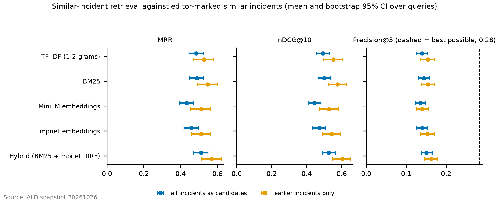
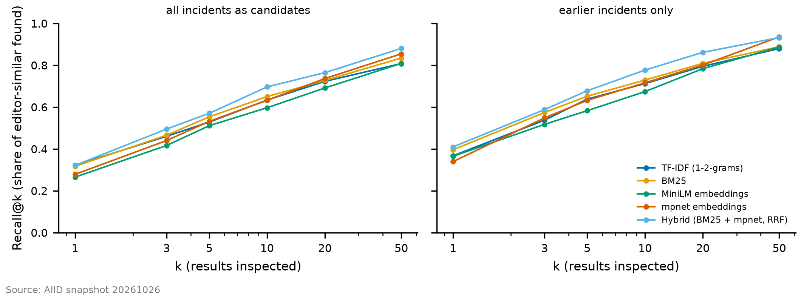

# RQ4: similar-incident retrieval (Phase 7)

_Auto-generated by `aicidentia.models.retrieval_outputs` (AIID snapshot **20261026**). Numbers are registered in `reports/results.json` under `rq4.*`._

## Summary

- **Ground truth:** AIID editors' own *similar incident* links in the snapshot, **no manual judgements were needed**. 447 incidents have at least one editor-marked similar incident in the analysis set (325 distinct pairs; 74.0% of queries have exactly one). Editor-marked *dissimilar* links (77 queries) serve as hard negatives.
- **Ranking by MRR:** Hybrid (BM25 + mpnet, RRF) > BM25 > TF-IDF (1-2-grams) > mpnet embeddings > MiniLM embeddings. Best: **Hybrid (BM25 + mpnet, RRF)**, MRR 0.510 [0.470, 0.549]; BM25 0.489 [0.451, 0.527].
- **Is the best method really better than BM25?** Primary test (paired bootstrap of the mean MRR difference): +0.022, 95% CI [-0.002, +0.046], not significant. The Wilcoxon signed-rank test, which looks at how often a query improves rather than by how much, disagrees (Holm-adjusted p = 0.0007; better on 178 queries, worse on 98, tied on 171).
- **Lexical vs semantic:** the best lexical method (BM25, MRR 0.489) scores higher than the best embedding model (mpnet embeddings, 0.458); MiniLM embeddings vs BM25 -0.055 [-0.086, -0.022] (significant); mpnet embeddings vs BM25 -0.031 [-0.061, +0.000] (not significant). A plausible explanation (not tested here) is that editor-linked incidents often share specific names of systems, companies or places, which exact-term matching rewards; the hybrid combines both signals.
- **Precedent search** (only earlier incidents as candidates, 242 queries): same picture, ranking Hybrid (BM25 + mpnet, RRF) > BM25 > TF-IDF (1-2-grams) > MiniLM embeddings > mpnet embeddings.
- **Deployed in the dashboard: BM25.** Hybrid (BM25 + mpnet, RRF) has the best mean MRR, but its advantage over BM25 is not significant by the primary test (paired bootstrap difference +0.022, 95% CI [-0.002, +0.046]); BM25 is deployed because it needs no embedding model and works offline. The other methods remain selectable.
- **AIID's own stored suggestions** (top 3 per incident) contain only 5.8% of the editor links and reach MRR@3 = 0.034, against 0.467 for Hybrid (BM25 + mpnet, RRF). So the editor links were not simply copied from those suggestions (which limits one source of bias in the ground truth).

## 1. Ground truth

- **Source:** `editor_similar_incidents` in the MongoDB snapshot (Phase 1 audit). A link A -> B is treated as relevant in both directions (symmetrised); links to incidents outside the 1,775-incident analysis set and self-links are dropped.
- **Queries:** the 447 incidents with at least one relevant incident; mean 1.45 relevant per query.
- **Ceilings:** because most queries have a single relevant incident, the best achievable mean Precision@5 is 0.283 (and P@3 0.447). MRR and nDCG@10 are therefore the informative metrics; P@5 is reported because the research question names it.
- **Incompleteness:** editors mark similar incidents when they notice them; an unmarked incident is not necessarily dissimilar. All methods are penalised equally for finding unmarked but genuinely similar incidents, so the comparison is fair, but absolute scores are lower bounds.
- **Hard negatives:** `editor_dissimilar_incidents` (symmetrised). 'Dissimilar in top 5' is the share of the top 5 that editors explicitly marked as *not* similar (lower is better).

## 2. Methods and protocol

Each incident is represented by its title + description (`text`), the same input as Phases 3 and 6. Fixed in advance; nothing was tuned on the ground truth:

- **TF-IDF:** word 1-2-grams, sublinear tf, English stopwords, min_df 2, cosine similarity.
- **BM25:** Okapi BM25 (k1 = 1.5, b = 0.75; `rank-bm25`) on the project's shared tokenisation (lemmatised, standard and domain stopwords removed).
- **MiniLM / mpnet:** cosine similarity of L2-normalised sentence embeddings (all-MiniLM-L6-v2, all-mpnet-base-v2; the same cached vectors as Phase 6).
- **Hybrid:** reciprocal rank fusion of the BM25 and mpnet rankings with k = 60 (the standard constant).

For each query every other incident is ranked; ties are broken by incident id. Metrics: MRR (reciprocal rank of the first relevant incident over the full ranking; primary), nDCG@10 (binary gains), Precision@5, Hit@5, Recall@k. Means carry percentile bootstrap 95% CIs over queries (2000 resamples). Each method is compared with BM25 on the same queries by a paired bootstrap of the mean MRR difference (primary) and the Wilcoxon signed-rank test with Holm correction across the four comparisons.

## 3. Results

### Setting: all other incidents are candidates; symmetrised editor links

| method | queries | MRR [95% CI] | nDCG@10 [95% CI] | P@5 | Hit@5 | Recall@10 | dissimilar in top 5 |
|---|---|---|---|---|---|---|---|
| TF-IDF (1-2-grams) | 447 | 0.485 [0.445, 0.523] | 0.492 [0.455, 0.530] | 0.14 | 59.5% | 0.633 | 0.003 |
| BM25 | 447 | 0.489 [0.451, 0.527] | 0.500 [0.464, 0.538] | 0.145 | 62.2% | 0.65 | 0.005 |
| MiniLM embeddings | 447 | 0.434 [0.396, 0.471] | 0.445 [0.410, 0.482] | 0.136 | 57.9% | 0.597 | 0.003 |
| mpnet embeddings | 447 | 0.458 [0.419, 0.496] | 0.472 [0.434, 0.509] | 0.14 | 59.3% | 0.632 | 0.003 |
| Hybrid (BM25 + mpnet, RRF) | 447 | 0.510 [0.470, 0.549] | 0.527 [0.491, 0.564] | 0.151 | 63.5% | 0.696 | 0.008 |

| method vs BM25 | MRR difference [95% CI] | p (paired bootstrap) | p (Wilcoxon) | p (Wilcoxon, Holm) | queries better / worse / tied |
|---|---|---|---|---|---|
| Hybrid (BM25 + mpnet, RRF) | +0.022 [-0.002, +0.046] | 0.072 | 0.0002 | 0.0007 | 178 / 98 / 171 |
| MiniLM embeddings | -0.055 [-0.086, -0.022] | 0.0005 | 0.0022 | 0.0067 | 139 / 181 / 127 |
| mpnet embeddings | -0.031 [-0.061, +0.000] | 0.051 | 0.203 | 0.333 | 155 / 156 / 136 |
| TF-IDF (1-2-grams) | -0.004 [-0.025, +0.018] | 0.767 | 0.167 | 0.333 | 128 / 137 / 182 |

### Setting: only incidents strictly earlier than the query are candidates (find precedents)

| method | queries | MRR [95% CI] | nDCG@10 [95% CI] | P@5 | Hit@5 | Recall@10 | dissimilar in top 5 |
|---|---|---|---|---|---|---|---|
| TF-IDF (1-2-grams) | 242 | 0.528 [0.470, 0.581] | 0.553 [0.498, 0.604] | 0.155 | 67.4% | 0.712 | 0.000 |
| BM25 | 242 | 0.548 [0.492, 0.599] | 0.576 [0.523, 0.626] | 0.155 | 69.0% | 0.729 | 0.000 |
| MiniLM embeddings | 242 | 0.512 [0.453, 0.564] | 0.528 [0.472, 0.581] | 0.14 | 63.2% | 0.674 | 0.010 |
| mpnet embeddings | 242 | 0.510 [0.458, 0.562] | 0.543 [0.489, 0.593] | 0.154 | 66.9% | 0.716 | 0.010 |
| Hybrid (BM25 + mpnet, RRF) | 242 | 0.569 [0.513, 0.620] | 0.603 [0.550, 0.651] | 0.162 | 71.5% | 0.777 | 0.000 |

| method vs BM25 | MRR difference [95% CI] | p (paired bootstrap) | p (Wilcoxon) | p (Wilcoxon, Holm) | queries better / worse / tied |
|---|---|---|---|---|---|
| Hybrid (BM25 + mpnet, RRF) | +0.021 [-0.014, +0.057] | 0.236 | 0.0319 | 0.0959 | 88 / 49 / 105 |
| MiniLM embeddings | -0.037 [-0.076, +0.005] | 0.074 | 0.137 | 0.274 | 70 / 83 / 89 |
| mpnet embeddings | -0.038 [-0.082, +0.008] | 0.119 | 0.195 | 0.274 | 78 / 75 / 89 |
| TF-IDF (1-2-grams) | -0.020 [-0.050, +0.009] | 0.179 | 0.024 | 0.0959 | 57 / 81 / 104 |

### Setting: only links in the direction the editor recorded them

| method | queries | MRR [95% CI] | nDCG@10 [95% CI] | P@5 | Hit@5 | Recall@10 | dissimilar in top 5 |
|---|---|---|---|---|---|---|---|
| TF-IDF (1-2-grams) | 416 | 0.470 [0.431, 0.511] | 0.501 [0.461, 0.541] | 0.125 | 58.7% | 0.658 | 0.003 |
| BM25 | 416 | 0.479 [0.440, 0.520] | 0.514 [0.475, 0.552] | 0.128 | 61.3% | 0.683 | 0.003 |
| MiniLM embeddings | 416 | 0.422 [0.382, 0.461] | 0.454 [0.415, 0.491] | 0.121 | 56.0% | 0.621 | 0.000 |
| mpnet embeddings | 416 | 0.446 [0.407, 0.483] | 0.482 [0.443, 0.520] | 0.127 | 58.9% | 0.66 | 0.000 |
| Hybrid (BM25 + mpnet, RRF) | 416 | 0.496 [0.456, 0.535] | 0.535 [0.497, 0.573] | 0.136 | 63.0% | 0.722 | 0.003 |

| method vs BM25 | MRR difference [95% CI] | p (paired bootstrap) | p (Wilcoxon) | p (Wilcoxon, Holm) | queries better / worse / tied |
|---|---|---|---|---|---|
| Hybrid (BM25 + mpnet, RRF) | +0.016 [-0.008, +0.042] | 0.19 | 0.0004 | 0.0017 | 169 / 89 / 158 |
| MiniLM embeddings | -0.057 [-0.091, -0.024] | 0.0005 | 0.0016 | 0.0049 | 128 / 173 / 115 |
| mpnet embeddings | -0.034 [-0.067, -0.001] | 0.046 | 0.189 | 0.189 | 149 / 144 / 123 |
| TF-IDF (1-2-grams) | -0.009 [-0.031, +0.012] | 0.421 | 0.0929 | 0.186 | 119 / 132 / 165 |

*Figure: MRR, nDCG@10 and Precision@5 per method with bootstrap 95% CIs. Source: AIID snapshot 20261026.*

*Figure: Recall@k per method. Source: AIID snapshot 20261026.*

### AIID's stored suggestions as a reference

The snapshot stores three NLP-based suggestions per incident (`nlp_similar_incidents`). Scored at depth 3 they reach MRR@3 = 0.034. Their provenance (model, input text, and when they were computed) is not documented in the snapshot; if they were computed when each incident was created, later incidents could not appear in them, which alone would depress their scores. They are shown for context, not as a competing method.

| method | queries | rr@3 | rr@3_low | rr@3_high | p@3 | p@3_low | p@3_high | hit@3 | hit@3_low | hit@3_high |
|---|---|---|---|---|---|---|---|---|---|---|
| aiid_nlp | 447 | 0.034 | 0.019 | 0.05 | 0.017 | 0.009 | 0.027 | 0.036 | 0.02 | 0.054 |

## 4. Examples (deployed method, titles only)

Two queries where an editor-similar incident appears in the top 5 and one where it does not (chosen by seed; incidents in the blind label-audit sample are excluded). Checked rows are editor-marked similar.

**Query #530: Telegram Channels Allowed Users to Make Non-Consensual Deepfake Porn as Paid Service** (first editor-similar incident at rank 5)

| rank | incident_id | title | similar |
|---|---|---|---|
| 1 | 1335 | OpenDream AI Platform Reportedly Commercialized AI-Generated CSAM and Non-consensual Deepfake Sexual Images |  |
| 2 | 480 | Non-consensual Deepfake Porn Targeted Female Content Creators |  |
| 3 | 1755 | Woman in Kyrgyzstan Alleged a Former Classmate Used an AI Bot to Create a Nude Image From Her Instagram Photo |  |
| 4 | 524 | Synthesized Voices Were Reportedly Used by Torswats to Sell Swatting Calls Targeting Schools and Homes |  |
| 5 | 782 | AI 'Nudify' Apps Used as Tools for Blackmail and Extortion | yes |

**Query #1488: ChatGPT Was Reportedly Consulted on Body-Disposal and Concealment Questions Before and After University of South Florida Doctoral Students Were Killed** (first editor-similar incident at rank 5)

| rank | incident_id | title | similar |
|---|---|---|---|
| 1 | 1487 | ChatGPT Was Alleged to Have Aided Planning of Florida State University Mass Shooting |  |
| 2 | 1270 | Multiple Purported AI-Assisted Cheating Incidents Reported Across South Korea's SKY Universities During October 2025 Midterms |  |
| 3 | 705 | Turkish Student in Isparta Allegedly Uses AI to Cheat on Exam, Leading to Arrest |  |
| 4 | 1071 | Student Reportedly Files Complaint Over Professor's Undisclosed Use of Generative AI at Northeastern University |  |
| 5 | 1490 | ChatGPT Was Allegedly Consulted About Attack Options Before Teen Attempted to Stab Officer at Tira, Israel, Police Station | yes |

**Query #664: Deepfake Generated by the Lincoln Project of Trump's Father Used in Political Attack Ad** (first editor-similar incident at rank 6)

| rank | incident_id | title | similar |
|---|---|---|---|
| 1 | 920 | Alleged Deepfake Scam Reportedly Promoted Trump Golden Eagles Project as Investment Opportunity |  |
| 2 | 681 | Never Back Down Super PAC for Ron DeSantis Uses AI Donald Trump Voice in Attack Ad Against Kim Reynolds |  |
| 3 | 1005 | Misleading Deepfake Video of Trump Mocking Zelenskyy for Clothing Goes Viral on Facebook |  |
| 4 | 862 | Purportedly AI-Generated Video Allegedly Depicts Martin Luther King Jr. Supporting Donald Trump |  |
| 5 | 1150 | Purported Deepfake of Barack Obama's Detention Reportedly Amplified by Donald Trump via Truth Social |  |

## 5. Limitations

- **Sparse, incomplete ground truth:** most queries have one relevant incident and editors do not mark every similar pair, so scores are lower bounds and small differences between methods are hard to detect.
- **Query selection:** only incidents with editor links are evaluated; they are mostly recent (2023-2026), when editors used the feature most, so results describe recent incidents best.
- **What 'similar' means to editors** (same system, same company, same kind of harm, a follow-up event) is not recorded; methods that match names are rewarded when editors link incidents about the same product.
- **Short texts:** only title + description are indexed; full report text might change the ranking (not tested, to keep the input identical across phases).
- **The hybrid's gain is small** and depends on the test used (see section 3); it is not deployed because the pre-specified rule requires a significant paired-bootstrap improvement.

